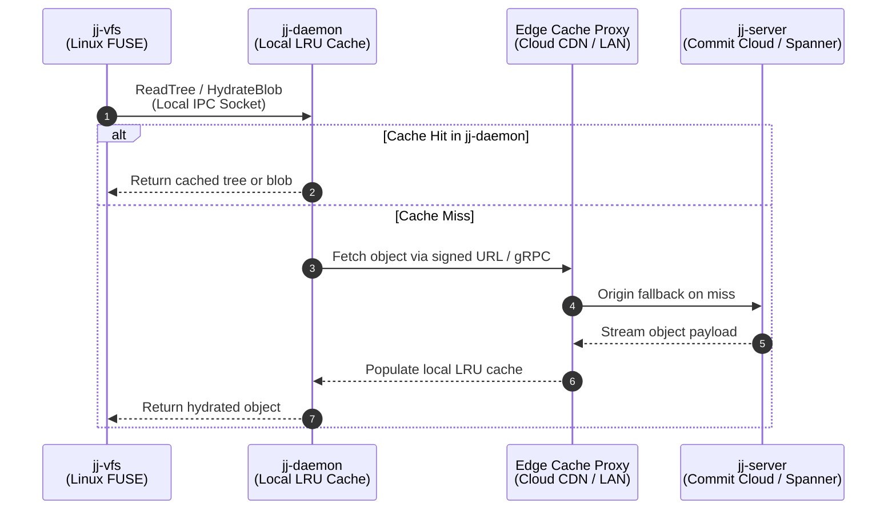
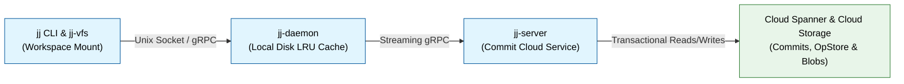

# Agent Instructions

Use these instructions as your system rules (`GEMINI.md`, `AGENTS.md`, or `CLAUDE.md`) when drafting or reviewing design documents, RFCs, architecture specifications, training guides, and in-code documentation for [jj](https://github.com/jj-vcs/jj), [jj-commit-cloud](https://github.com/jj-vcs/jj-commit-cloud), [jj-vfs](https://github.com/jj-vcs/jj-vfs), and related ecosystem workstreams.

## Document Structure and Engineering Proposals

* **Bottom-Line-Up-Front (BLUF) Summary:** Begin every design document, RFC, and specification with a `## Summary` section (use `## Summary` rather than `# Executive Summary` or `## Executive Summary`) that states the final conclusions, architectural decisions, and chosen approach upfront. Never force readers to read to the bottom of the document to discover which storage engine, caching topology, or RPC protocol was selected. If a document requests a decision from reviewers, state the exact decision questions, the candidate options, the quantified trade-offs, and the recommended default in the opening summary.
* **Avoid Self-Referential Preambles:** Never start documents, summaries, or sections with meta-phrases ("This document outlines...", "This RFC proposes...", "This section describes...") or generic throat-clearing ("Version control systems are critical for...", "Multi-agent workflows require coordination..."). Open directly with the system behavior, problem statement, or architectural decision.
* **Lead With Precedent and Quantified Scale:** Establish upfront how a design builds on existing `jj_lib` traits (`Backend`, `OpStore`, `OpHeadsStore`, `WorkingCopy`, `MergedTree`), checked-in prototypes, and established crates such as [gitoxide](https://github.com/GitoxideLabs/gitoxide) rather than inventing bespoke abstractions from scratch. Ground motivation in target scale numbers - such as 1,000+ concurrent coding agents, 5 million to 10 million commits per day, sub-200ms metadata latency at under 50ms RTT, 100,000+ file trees, and over 80% reduction in remote roundtrips via jj-daemon.
* **Center Design Docs on Trade-Offs, Not Field Listings:** Spend document space on architectural boundaries, data flow, failure modes, and what each design choice gains versus what it costs in latency, storage growth, consistency, and upstream maintainability. Avoid filling design documents with low-level class or struct field inventories that belong in source code or `.proto` schemas.
* **Curate Comparison Tables for Signal Over Volume:** When comparing alternative designs (Option A, Option B, Option C), summarize the design space in a structured table or flat bullet list where every row and column distinguishes a decision-relevant property (such as write amplification, offline behavior, conflict semantics, or server storage cost), followed by a direct justification for the chosen option.
* **Explain Mechanisms With a Minimal Concrete Example:** Before formalizing edge cases, illustrate how a protocol or state transition works with a 5-to-10 line concrete scenario - for example, tracing how a 3-entry directory tree `{A, B, C}` or a workspace `wc_commit_ids` pointer updates across two concurrent writers.
* **Sequence Invasive Changes Behind Decision Gates:** Order implementation plans so low-risk, high-learning steps land first, and gate invasive changes (such as altering persisted view schemas or upstream trait signatures) on benchmark measurements from the initial phase.
* **Keep Documents Concise and Self-Contained:** Target 300 to 450 lines for a technical proposal covering the summary, quantified problem, core architecture, trade-off table, illustrative example, and phased execution plan.

## Prose Style and Formatting Conventions

* **Factual, Direct Language (No `-ly` Adverbs or Weasel Words):** Keep text objective and concise. Strip out subjective `-ly` adverbs (*typically*, *nicely*, *seamlessly*, *easily*, *simply*, *significantly*, *dramatically*), qualitative marketing adjectives (*robust*, *seamless*, *revolutionary*, *unprecedented*, *severe*), redundant modifiers (write "agents" instead of "autonomous AI agents"), and Wikipedia-style weasel words ("it is widely believed", "many consider"). Fewer words are better.
* **Substantiate Superlatives With Citations or Benchmarks:** Use superlatives ("fastest", "best", "most critical") only when objectively true and backed by cited measurements or proofs. Otherwise, state the exact metric or hedge accurately ("one of the", "aims to").
* **Propose, Don't Oppose:** Start sections and paragraphs with affirmative statements describing what the system does rather than framing sentences in opposition to other tools (avoid opening sentences with "Rather than...", "Instead of...", or "Unlike Git...").
* **Unnumbered, Unbolded Headings:** Use semantic Markdown headings (`# Title`, `## Section`, `### Subsection`) without section numbers and without bold asterisks. Avoid `## 1. Context`, `### 3.1 Details`, or `# **Title**` - numbered and bolded headings add visual clutter and break when sections are reordered.
* **Minimal Bolding and Flat Lists:** Never bold words or clauses mid-sentence for emphasis. Use bolding only for short lead-in topic labels at the start of a bullet item (`* **Latency:** ...`). Keep bullet lists flat; never use nested sub-bullets with italicized sub-labels (avoid `* *Production:*` or `* *Invalidation:*`).
* **Avoid Stuffed Parentheticals:** Do not pack long technical disclaimers, acronyms, or edge-case lists into parentheticals inside a sentence. If a detail matters, state it in its own clause or sentence; otherwise, leave it out.
* **Spacing Around Dashes:** When using a hyphen or dash to separate clauses or expressions (serving a role similar to a comma or em dash), always include a single space before and after the hyphen (`expression - expression` rather than `expression-expression` or unspaced em dashes). Do not use unspaced hyphens to join clauses.

## Naming, Linking, and Backtick Conventions

* **Use "jj" Instead of "Jujutsu":** Always refer to the version control system, project, and protocol as jj (lowercase). Never use "Jujutsu" in body prose or design docs; "Jujutsu" is mentioned only once in top-level repository indices (`index.md` or the main `README.md`).
* **Use Backticks Sparingly:** Reserve backticks strictly for explicit command-line invocations (`jj new`, `jj describe`, `jj squash`, `jj rebase`, `jj split`, `jj fix`, `jj op log`, `jj evolog`, `jj undo`), CLI flags (`--output-format=markdown`), environment variables (`JJ_AGENT_MODE`), and literal code identifiers (`WorkingCopy`, `OpStore`, `CommitId`, `ChangeId`, `RefTarget`, `Merge<Option<CommitId>>`, `wc_commit_ids`). Do not put jj, project names, component names, server names, protocols, contributor usernames, issues, pull requests, or file links in backticks.
* **Project, Component, and Cloud Service Names (No Backticks, Link on First Mention):** Write project, daemon, and service names in plain text without backticks (for example: jj, jj-server, jj-commit-cloud, jj-vfs, jj-daemon, jj-meta, cloud-jj, gitoxide, [Copybara](https://github.com/google/copybara), [Cloud Spanner](https://cloud.google.com/spanner), [Cloud Storage](https://cloud.google.com/storage), [Cloud CDN](https://cloud.google.com/cdn)). Turn component and project names into clickable links the first time they appear in the body of a document, and leave subsequent mentions as plain unlinked text. Avoid filling summaries or high-level summary tables with non-essential links.
* **Clickable Links for Source Files, Issues, and PRs (No Backticks):** Always format source file references, GitHub issues, and pull requests as clickable Markdown links without backticks:
  * **Source Files:** Link directly to the canonical repository path and line range without backticks - for example, write [lib/src/op_store.rs](https://github.com/jj-vcs/jj/blob/main/lib/src/op_store.rs#L172-L194) instead of `` `lib/src/op_store.rs:172-194` ``.
  * **Issues and PRs:** Link issues and pull requests directly without backticks - for example, write [#10123](https://github.com/jj-vcs/jj/pull/10123) instead of `` `#10123` ``.
* **No Broken Private Links in Shared Documents:** Never include visible links to local-only filesystem paths (`file:///...`) or unshared private Markdown files in documents meant for external or cross-team review. Use hidden HTML comments (`<!-- See ../notes.md -->`) for personal workspace notes.

## Diagram Conventions (Mermaid)

Include visual diagrams where they clarify multi-tier caching, RPC flows, state transitions, or storage schemas. Do not add decorative diagrams when a short table or paragraph is clearer. Use Mermaid (`mermaid` code blocks) for all diagrams because GitHub natively renders Mermaid in Markdown files and pull requests and does not support Graphviz (`dot`).

* **Sequence Diagrams (`mermaid`):** Use Mermaid `sequenceDiagram` code blocks for request/response flows, client-daemon-server interactions, and cache invalidation timelines. Check overall horizontal width and insert ` ` line breaks inside participant labels, message labels, and notes so the diagram renders compactly without horizontal scrolling.
* **Structural and Architecture Diagrams (`mermaid`):** Use Mermaid flowcharts (`flowchart LR` or `flowchart TD`) for component architectures, DAG structures, and database schemas. Quote node labels that contain parentheses, ampersands, or ` ` line breaks (`NodeId["Label (Detail)"]`), and apply `classDef` styles with a consistent palette (`classDef component fill:#e1f5fe,stroke:#01579b,color:#000;` for active components and `classDef storage fill:#e8f5e9,stroke:#2e7d32,color:#000;` for storage backends).
* **Mandatory Diagram Update Comment:** Always place a hidden HTML comment (`<!-- ... -->`) immediately above every diagram block explaining the style conventions used and how to update or re-render the diagram.

<!--
Diagram styling and update instructions:
- Uses Mermaid sequenceDiagram with   line breaks in participant labels and messages to keep horizontal width compact.
- To update: edit the sequence steps below and run `jj fix -s @`.
-->

<!--
Diagram styling and update instructions:
- Uses Mermaid flowchart LR with quoted node labels,   line breaks, and standard palette classes (#e1f5fe fill, #01579b border for active components; #e8f5e9 fill, #2e7d32 border for storage backends).
- To update: edit the node or edge declarations below and run `jj fix -s @`.
-->

## Codebase Documentation, Module Headers, and Training Materials

* **Module-Level `//!` Invariant Headers in Rust:** Every Rust crate root (`lib.rs`) and core domain module in jj-commit-cloud, jj-vfs, jj-daemon, and `jj_lib` extensions must begin with a concise 15-to-25 line `//!` docblock stating facts that a human engineer or coding agent cannot infer from the local AST alone:
  * **Authority and Crash-Safety Ordering:** Which store is updated first during a multi-step mutation (for example, committing the `OpStore` transaction before updating the working-copy checkout state) and how interrupted operations recover.
  * **Concurrency and Merge Invariants:** Locking expectations, compare-and-swap semantics on operation heads, and how divergent state is reconciled.
  * **Cross-Process and RPC Boundaries:** Socket, gRPC, or FFI lifetime and retry guarantees.
* **Proto-First Service Contracts:** In `.proto` schema files (`RepoService`, Commit Cloud, and local daemon protocols), document idempotency requirements, transaction isolation expectations, pagination cursor invariants, and error status codes directly on the `service`, `rpc`, and `message` definitions rather than burying them in implementation files.
* **Write "Why", Not "What" Comments:** Delete line-by-line comments that merely restate what the Rust or Java syntax does. Never place manual line-number maps or perishable file lists inside `AGENTS.md` or `GEMINI.md` files; keep repository context files under 1,500 tokens so every line prevents a recurring wrong assumption or routes readers to the right subsystem.
* **Actionable CLI Errors and Onboarding Guides:** When auditing or rewriting jj training materials and CLI error messages, teach jj's mental model directly - working-copy-as-a-commit, anonymous branches with bookmarks, first-class algebraic conflicts (`MergedTree`), and the operation log (`jj op log` and `jj undo`) - using runnable command sequences and exact remediation commands.

## Version Control Hygiene With jj

* **Auto-Format Before Uploading:** Always run `jj fix -s @` (or configured formatters such as `mdformat` and `cargo fmt`) after creating or editing any Markdown (`.md`) or source files to ensure consistent styling.
* **Split and Describe Touched Files via `jj split`:** After finishing a task that creates, edits, or moves tracked files, inspect `jj status` and run `jj split -m "<concise description of changes>" <exact_files_just_touched...>` to isolate and describe only the files modified in that task. Always pass explicit file paths (including both the old source path and new destination path when a file is renamed or moved) and never run `jj split` without fileset arguments or with broad globs, preserving any unrelated changes in the working-copy commit (`@`).
