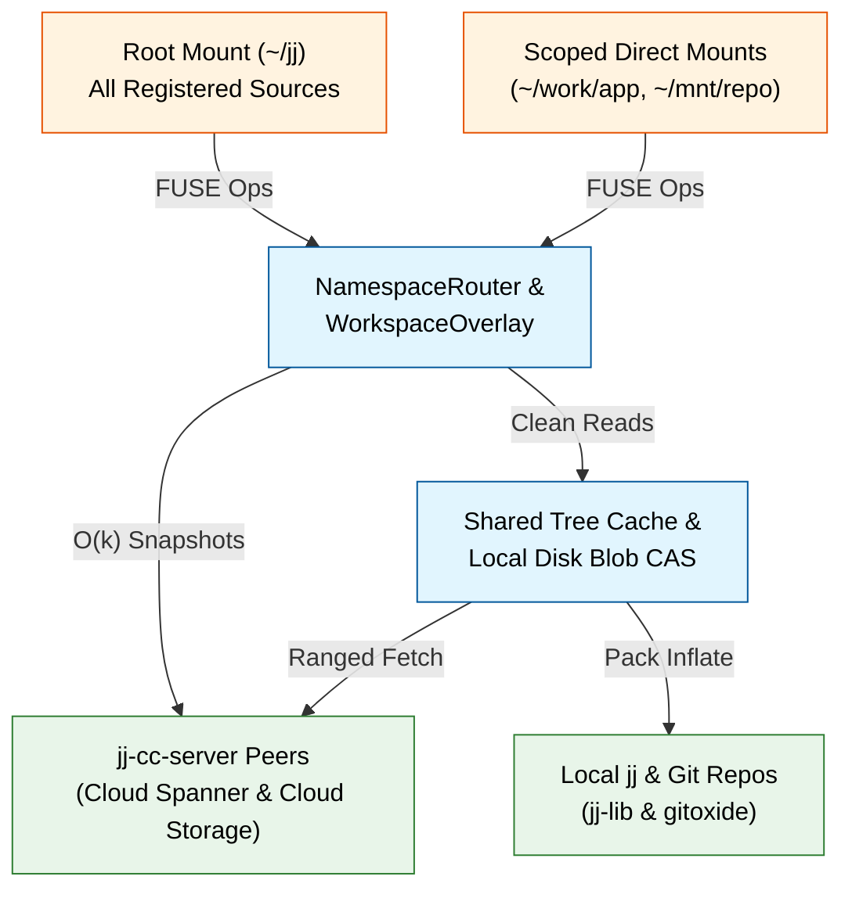

# jj-vfs

jj-vfs is a virtual filesystem for [jj](https://github.com/jj-vcs/jj) (Jujutsu) that mounts remote [jj-commit-cloud](https://github.com/jj-vcs/jj-commit-cloud) workspaces, commits, bookmarks, and change trees alongside local jj and Git repositories via Linux FUSE without cloning packfiles or materializing untouched files on disk.

When dozens of engineers or coding agents work on the same repository, cloning history and walking every directory on each jj command multiplies disk space, network traffic, and snapshot latency. jj-vfs replaces full checkouts and $O(N)$ working-copy tree scans with on-demand ranged reads, a shared local content-addressed blob cache, a durable per-workspace write overlay, and an $O(k)$ `WorkingCopy` implementation that uploads only the $k$ tracked files modified since the previous snapshot.

## Core Concepts

### Per-User Daemon and Multi-Source Registry

A single per-user daemon (jjfsd) runs under the caller's OS UID and listens on `$XDG_RUNTIME_DIR/jj-vfs/control.sock` while persisting registered sources in `$XDG_CONFIG_HOME/jj-vfs/config.toml`. One jjfsd process connects to multiple backing destinations at the same time - such as a corporate jj-cc-server deployment, an open-source jj-cc-server deployment, and offline local jj or Git repositories backed by `jj_lib` and [gitoxide](https://github.com/GitoxideLabs/gitoxide). All active workspaces share one sharded inode table, one in-memory tree cache, and one bounded local disk blob cache (`$XDG_CACHE_HOME/jj-vfs/cas/`).

Passing `--instance <name>` or `--state-dir <path>` starts an isolated jjfsd instance with its own socket, state directory, and FUSE mounts for automated tests and container sandboxes.

<!--
Diagram styling and update instructions:
- Uses Mermaid flowchart TD with at most 2 peer nodes per rank and <br/> line breaks under 25 characters per line so rendered width stays under 700px.
- Standard palette classes: #fff3e0 / #e65100 for kernel mounts, #e1f5fe / #01579b for jjfsd components, and #e8f5e9 / #2e7d32 for storage backends.
- To update: edit node or edge declarations below and preview the rendered Mermaid block in Markdown.
-->


### Root Namespace Mount and Scoped Direct Mounts

jjfsd supports two mount modes inside the same process:

* **Root Namespace Mount (`jj vfs mount ~/jj`):** Exposes every registered source under `<mount>/<source>/repos/<repo>/...` and `<mount>/<source>/users/<user>/...` (plus `<mount>/<source>/me` pointing to the caller's user view). Navigating into any repository, workspace, bookmark, change ID, or commit prefix requires zero additional `mount` syscalls.
* **Scoped Direct Mounts (`jj vfs mount <target> <dir>`):** Mounts a specific workspace (`corp:webapp/default`), repository (`corp:webapp`), user view (`corp:@alice`), or source (`corp`) directly onto `<dir>` without outer `[source]` or `[repo]` path prefixes. Mounting a workspace directly places `.jj/` at `<dir>/.jj` and creates a kernel `st_dev` filesystem boundary so upward directory walks by compilers, build tools, and language servers stop at `<dir>`.

Inside a Root or Source mount, both `<source>/repos/<repo>/workspaces/<ws>` and `<source>/users/<user>/<repo>/<ws>` resolve through relative POSIX symlinks to the canonical workspace directory `<source>/repos/<repo>/users/<user>/<ws>`, guaranteeing one inode subtree and one write overlay per workspace:

```text
~/jj/
└── corp/
    ├── me -> users/alice@example.com
    ├── repos/
    │   └── webapp/
    │       ├── workspaces/
    │       │   └── default -> ../users/alice@example.com/default
    │       ├── users/
    │       │   └── alice@example.com/
    │       │       └── default/             # Read-write workspace + synthesized .jj/
    │       ├── commits/
    │       │   └── <commit_id_or_prefix>/   # Read-only tree (40-hex ID or >=12-hex prefix)
    │       ├── changes/
    │       │   └── <change_id> -> ../commits/<commit_id>
    │       └── bookmarks/
    │           └── main -> ../commits/<commit_id>
    └── users/
        └── alice@example.com/
            └── webapp/
                └── default -> ../../../repos/webapp/users/alice@example.com/default
```

### Write Overlay, Ignored Build Outputs, and Zero-Walk Snapshots

Every mutable workspace stores writes in a durable local overlay under `$XDG_STATE_HOME/jj-vfs/overlays/`:

* **`.gitignore` Separation:** jjfsd evaluates repository `.gitignore` rules using `jj_lib`. Build outputs (`target/`, `node_modules/`, object files, and editor swap files) write into `overlay/ignored/` as local POSIX files and never upload to Commit Cloud.
* **Crash-Safe Tracked Writes:** Edits to tracked files write into `overlay/staged/` and append a record to `overlay/journal.log` before FUSE `write()` or `fsync()` returns, recovering dirty state across daemon restarts and keeping un-snapshotted edits outside the LRU eviction pool.
* **$O(k)$ Working Copy Integration:** A background task snapshots quiet tracked edits every $2\text{ s}$ when the remote working-copy head matches the cached base and is resolved without descendants requiring rebase. Running jj commands (`jj status`, `jj diff`, `jj describe`, `jj new`, `jj rebase`) inside a mounted Commit Cloud workspace invokes `VfsWorkingCopy` over `control.sock` in two phases - uploading the $k$ dirty paths in `journal.log` during `snapshot()` while keeping staged files intact until `finish()` commits the new head via `CheckoutTree` and invalidates kernel cache entries for changed paths. Multi-side conflicted commits (`Merge<TreeId>` and `ConflictLabels`) preserve all conflict terms across checkouts; dirty overlays on unresolved conflicts return an error rather than collapsing conflict sides.

## Everyday Workflows

### Building the Binaries

Build jjfsd, the standalone `jj-vfs` control CLI, and the integrated `jj` binary ([crates/jjfsctl/src/jj_main.rs](crates/jjfsctl/src/jj_main.rs)), which registers Commit Cloud storage factories, `VfsWorkingCopy` (working-copy type `"vfs"`), and `jj vfs` subcommands (a stock `jj` binary cannot load `"vfs"` workspaces):

```bash
cargo xtask build --export-bin
# Prepending ./bin puts the integrated jj binary ahead of any system jj in this shell
export PATH="$PWD/bin:$PATH"
```

### Registering Sources and Mounting Workspaces

Start a local jj-cc-server (from a sibling `jj-commit-cloud` checkout) or point at an existing Commit Cloud endpoint, register sources in jjfsd, and mount both the global namespace and a direct workspace directory:

```bash
# Register remote Commit Cloud servers and a local repository directory
jj vfs source add corp --server http://127.0.0.1:8080 --user alice@example.com
jj vfs source add local --path .

# Mount the multi-source root namespace at ~/jj
jj vfs mount ~/jj

# Or mount a single workspace directly without [source] or [repo] path segments
jj vfs mount corp:webapp/default ~/work/webapp
```

### Editing, Running jj Commands, and Inspecting Status

Work inside `~/work/webapp` (or `~/jj/corp/repos/webapp/workspaces/default`) with standard POSIX editors, compilers, and jj commands:

```bash
cd ~/work/webapp
echo 'pub fn ready() -> bool { true }' > src/lib.rs

# Triggers an O(k) VfsWorkingCopy snapshot with zero directory tree walks
jj diff --git
jj describe -m "feat: add ready helper"
jj new -m "next change"

# Inspect live daemon cache stats, sources, and active FUSE mounts
jj vfs daemon status

# Flush pending snapshots and detach mounts
jj vfs unmount ~/work/webapp
jj vfs unmount ~/jj
```

### Smoke Tests and Multi-Workspace Benchmarks

Verify multi-source routing, read-write overlays, `.gitignore` filtering, and $50$-workspace cache sharing across two live jj-cc-server instances plus a local jj repository. FUSE mount tests require `/dev/fuse`, and Commit Cloud end-to-end tests (`vfs_cli_e2e`, `cargo xtask smoke`, and `cargo xtask bench`) locate `jj-cc-server` via `JJ_CC_SERVER_BIN` or a sibling `../jj-commit-cloud` build (setting `JJ_VFS_REQUIRE_E2E=1` fails `vfs_cli_e2e` if `/dev/fuse` or `jj-cc-server` is unavailable):

```bash
cargo test --workspace
cargo xtask smoke
cargo xtask bench --workspaces 50
```

## Documentation and Repository Layout

* **Architecture and MVP Design Proposal:** [docs/design.md](docs/design.md)
* **Shared FUSE Core Architecture (Birdstride):** [src/core_vfs/README.md](src/core_vfs/README.md) and [src/core_vfs_bridge.rs](src/core_vfs_bridge.rs)
* **Namespace Router and Scoped Mounts:** [src/namespace.rs](src/namespace.rs) and [src/daemon.rs](src/daemon.rs)
* **Durable Write Overlay and `.gitignore` Split:** [src/overlay.rs](src/overlay.rs)
* **Zero-Walk Snapshots and `VfsWorkingCopy`:** [src/snapshot.rs](src/snapshot.rs) and [src/vfs_working_copy.rs](src/vfs_working_copy.rs)
* **Commit Cloud and Local Storage Backends:** [src/backend/commit_cloud.rs](src/backend/commit_cloud.rs) and [src/backend/local.rs](src/backend/local.rs)
* **Control Protocol and CLI:** [crates/vfs-proto/src/lib.rs](crates/vfs-proto/src/lib.rs) and [crates/jjfsctl/src/lib.rs](crates/jjfsctl/src/lib.rs)
* **Smoke and Benchmark Harness:** [crates/xtask/src/main.rs](crates/xtask/src/main.rs)

## License

Licensed under the Apache License, Version 2.0. Every source file carries the standard Apache 2.0 license header.
