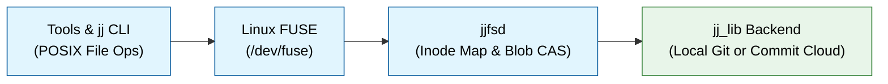

# Documentation and RFC Instructions

Apply these conventions alongside [AGENTS.md](../AGENTS.md) when drafting or editing design documents, RFCs, architecture specifications, and guides under `docs/` or [README.md](../README.md).

## Document Structure and Engineering Proposals

* **Bottom-Line-Up-Front (BLUF) Summary:** Open every design document, RFC, and specification with `## Summary` stating the final architectural decisions and chosen approach upfront. When requesting a decision, list the decision questions, candidate options, trade-offs, and recommended default in `## Summary`.
* **No Self-Referential Preambles:** Never open documents or sections with meta-phrases ("This document outlines...", "This RFC proposes..."). Start with system behavior, constraints, or decisions.
* **Separate Current Code From Planned Design:** Distinguish what runs on `main` today from planned architecture, and add CLI commands to quickstart guides in the commits that implement them. Every relative link must resolve to a path present in that commit.
* **Ground Designs in Precedent and Trade-Offs:** Build on `jj_lib` traits (`Backend`, `OpStore`, `OpHeadsStore`, `WorkingCopy`, `MergedTree`), `fuser`, and [gitoxide](https://github.com/GitoxideLabs/gitoxide), compare options in compact trade-off tables, illustrate state transitions with a 5-to-10 line concrete scenario, sequence invasive changes behind measurement gates, and target 300 to 450 lines per proposal.

## Prose Style, Naming, and Linking

* **Direct Language (No `-ly` Adverbs or Weasel Words):** Strip subjective `-ly` adverbs (*typically*, *seamlessly*, *easily*, *simply*, *significantly*), marketing adjectives (*robust*, *revolutionary*), and weasel words. Substantiate superlatives with measurements.
* **Propose, Don't Oppose:** Open sentences with affirmative descriptions rather than opposition ("Rather than...", "Instead of...", "Unlike Git...").
* **Headings, Lists, and Dashes:** Use unnumbered, unbolded headings (`# Title`, `## Section`), bold only short bullet lead-in labels (`* **Latency:** ...`) in flat lists, avoid stuffed parentheticals, and use spaced hyphens (`expression - expression`) instead of em dashes or unspaced clause hyphens.
* **Naming and Backticks:** Refer to the VCS as jj (mention "Jujutsu" at most once in [README.md](../README.md)). Reserve backticks for CLI invocations (`jj status`, `jj fix -s @`), flags, environment variables, and literal code/file identifiers (`WorkingCopy`, `CommitId`, `Merge<TreeId>`, `fuser::Filesystem`). Write project and binary names without backticks (jj, jj-vfs, jjfsd, jj-commit-cloud), linking first mentions.
* **Relative In-Repo Links:** Link repository files with relative paths without backticks - such as [src/lib.rs](../src/lib.rs) - so links work across forks and branches. Never include `file:///` links.

## Diagram Conventions (Mermaid)

Use Mermaid (`mermaid` blocks) for timelines (`sequenceDiagram`) and layouts (`flowchart TD` or `flowchart LR`), inserting ` ` breaks and quoting labels so diagrams fit page width. Place an HTML comment (`<!-- ... -->`) above every diagram stating its palette and how to edit it:

<!--
Diagram styling and update instructions:
- Uses Mermaid flowchart LR with quoted node labels,   line breaks, and standard palette classes (#e1f5fe fill, #01579b border for active components; #e8f5e9 fill, #2e7d32 border for storage backends).
- To update: edit the node or edge declarations below and preview the rendered Mermaid block in Markdown.
-->

