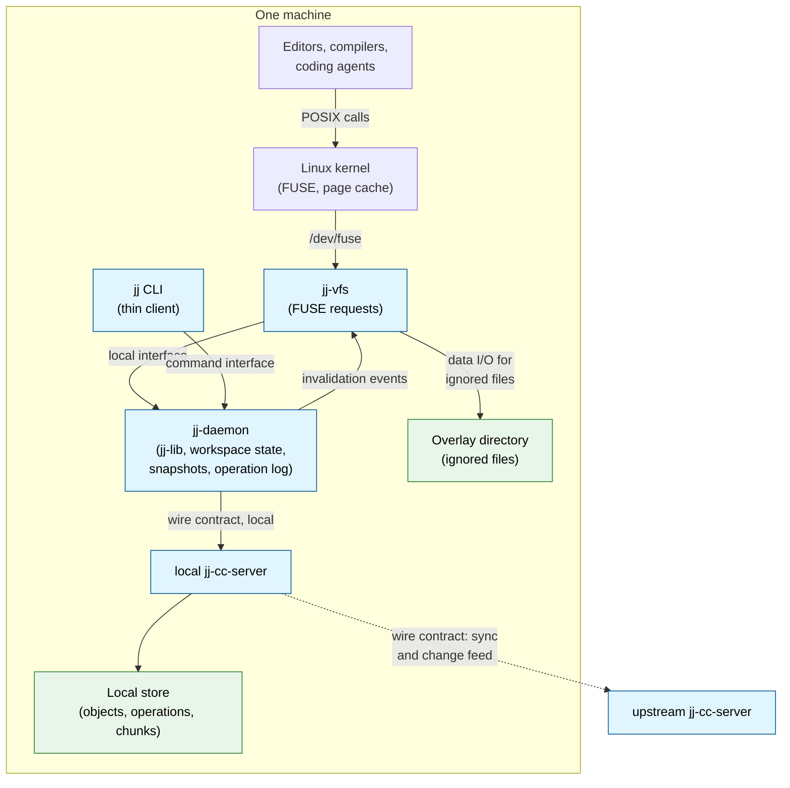
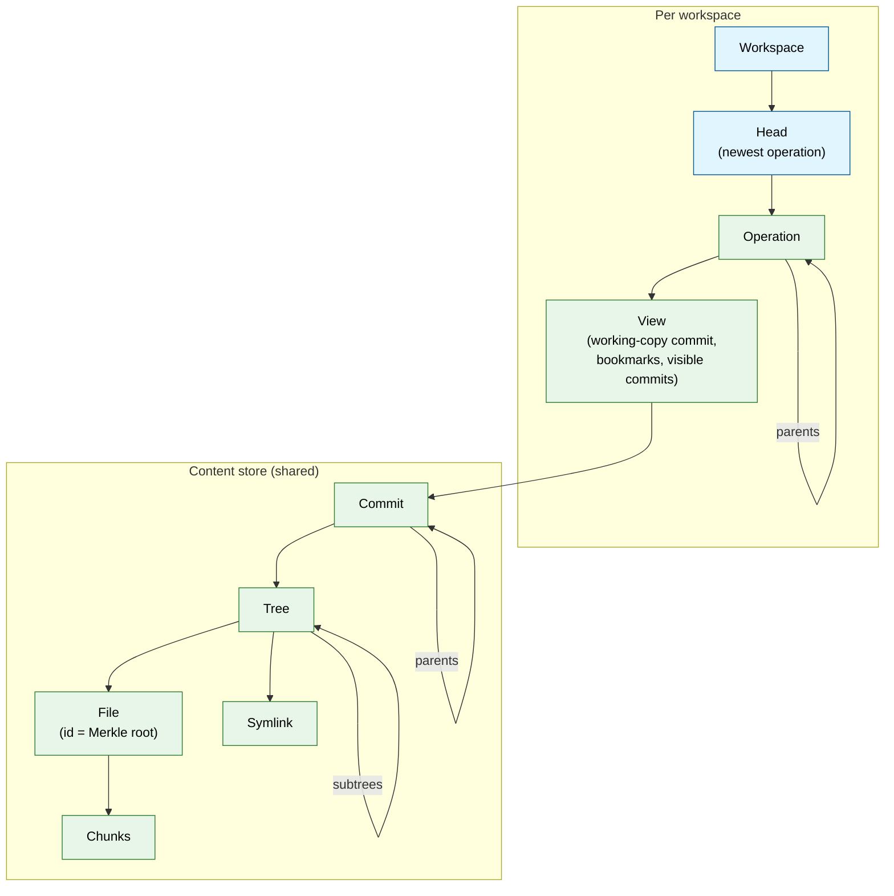
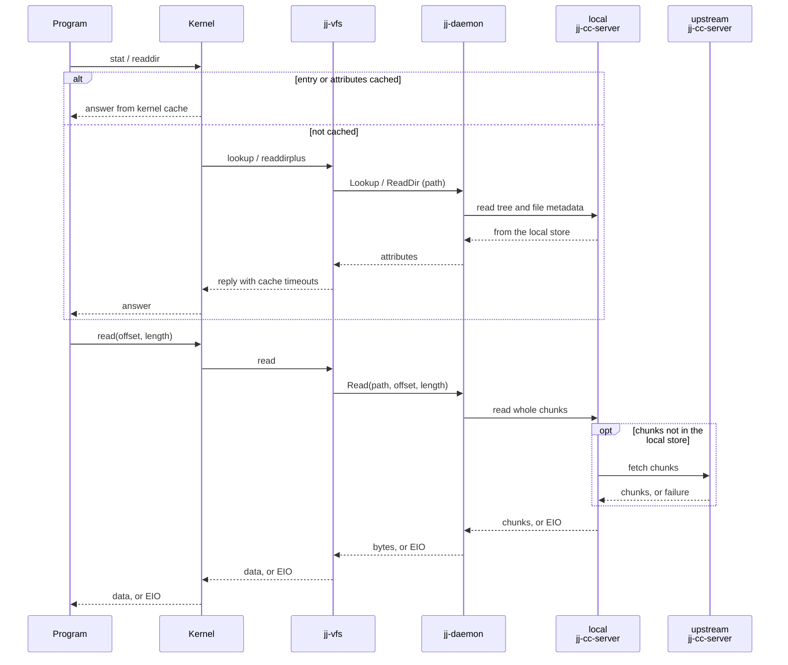
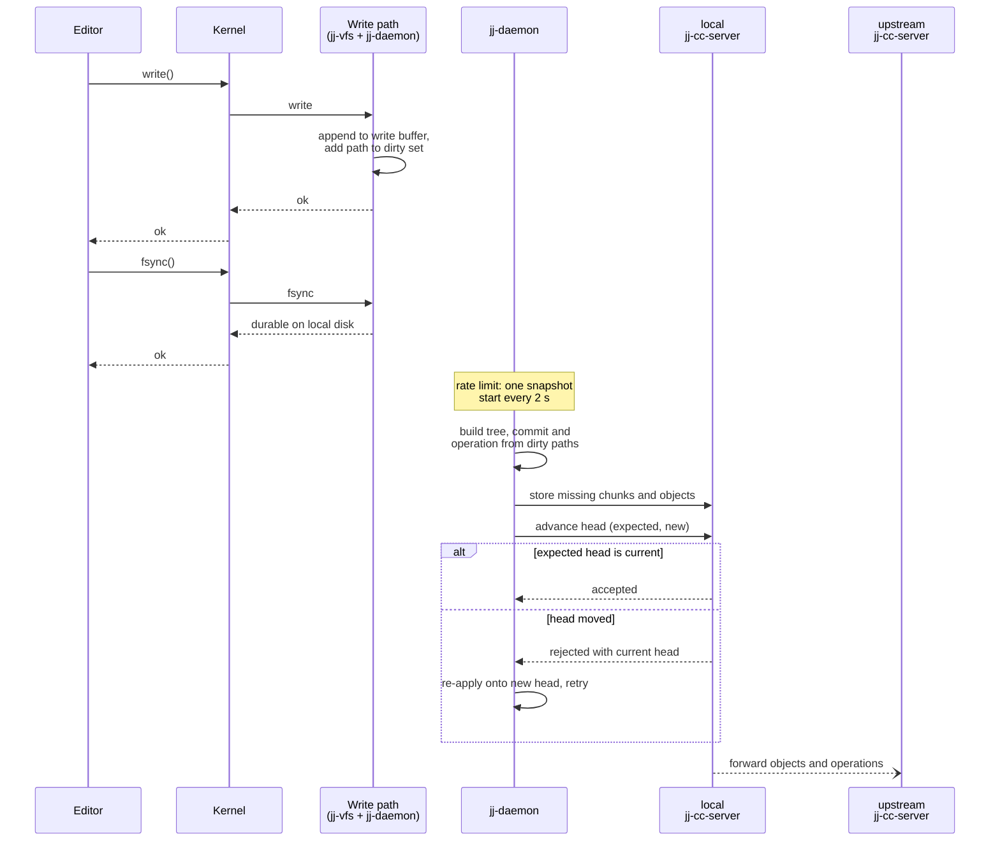
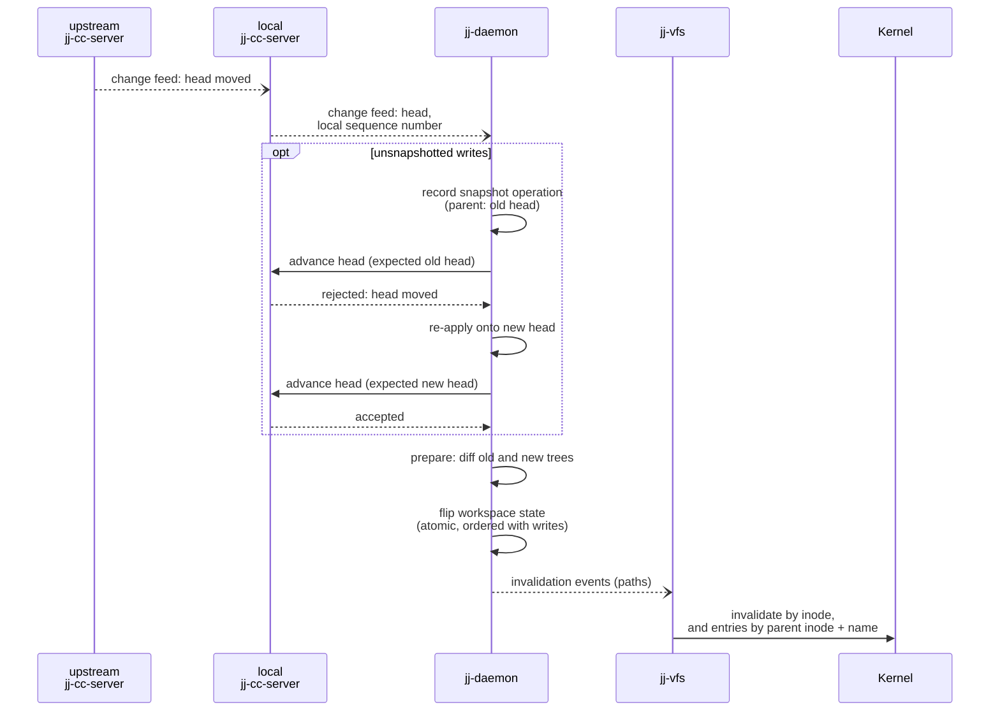

# jj-vfs architecture

## Summary

Large repositories with many workspaces, often one per coding agent, cost disk space and time when each workspace is a full checkout. jj with a Git remote also shares work only after an explicit push and fetch. jj-vfs presents each [jj](https://github.com/jj-vcs/jj) workspace as an ordinary Linux directory tree through [FUSE](https://www.kernel.org/doc/html/latest/filesystems/fuse.html). It fetches content when a program first reads it, takes jj snapshots of saved files without a manual step, and shares them with other machines through [jj-commit-cloud](https://github.com/jj-vcs/jj-commit-cloud).

For each operating-system user, four kinds of process take part on a machine:

* **jj-vfs:** answers kernel FUSE requests. It does filesystem work only and does not link jj-lib.
* **jj-daemon:** owns version control - the workspace state, snapshots, ignore rules, the operation log and sync. It links [jj-lib](https://docs.rs/jj-lib) and is the only process that talks to a jj-cc-server.
* **jj CLI:** a thin client of jj-daemon, started per command. All of its store access goes through jj-daemon.
* **Local jj-cc-server:** the commit-cloud server binary on the same machine. It holds the machine's copy of objects and operations and syncs with an upstream jj-cc-server in the background.

Terms used throughout: unsnapshotted writes are file writes that no snapshot holds yet; the write buffer is the persistent local store that holds them; the dirty set is the set of paths they touch.

Key choices:

* **No network on the write path:** `write()` and `fsync()` never wait on the network, and metadata already on the machine is served without it. A first read of content that is not on the machine waits for a fetch.
* **Snapshots from the dirty set:** never from a tree walk, and at most one snapshot starts every 2 s.
* **Chunked files:** file content is stored as chunks and named by SHA-256 digests.
* **No exclusive locks:** concurrent writers are reconciled after the fact.

Most of this design is not implemented yet; [What works now](#what-works-now) lists what runs today.

## Goals and constraints

Goals:

* **Local feel:** a workspace behaves like a local directory for editors, compilers and coding agents, including many workspaces on one machine.
* **Durable saves:** an acknowledged write is never lost to a crash of jj-vfs or jj-daemon, subject to the writeback-cache question in [Open questions](#open-questions).
* **Remote visibility:** changes made on one machine appear on other machines that follow the same workspace, without a user command.
* **Several writers:** one person or agent writes a workspace in the common case; several at once are allowed, for example a person and an agent in the same workspace, or one workspace mounted on two machines.
* **jj inside the mount:** jj commands run inside a mounted workspace and see the same state the filesystem shows.

Constraints:

* **Platform:** Linux with FUSE, kernel 6.14 or later. Features from newer kernels are used only when the kernel reports them during FUSE initialization.
* **Language:** Rust for all components.
* **Network:** nothing that crosses a network is expected to be in sync. Long-running local processes that talk over Unix sockets - jj-vfs with jj-daemon, and jj-daemon with the local jj-cc-server - may rely on each other's answers being current.
* **jj project:** the design builds on jj-lib's store traits - `Backend`, `OpStore`, `OpHeadsStore` and `WorkingCopy` - so changes jj needs can be proposed to the jj project.

## System context

<!--
Diagram styling and update instructions:
- Mermaid flowchart TD with quoted labels and   line breaks.
- Palette: classDef component (#e1f5fe fill, #01579b border) for processes; classDef storage (#e8f5e9 fill, #2e7d32 border) for storage. Unstyled nodes (programs, kernel) are outside this design.
- Solid edges are local calls and streams; dotted edges cross the network asynchronously. The same meaning holds in every diagram of this document.
- The subgraph marks what runs on one machine for one operating-system user.
- To update: edit the nodes and edges below; check the result in a GitHub preview or with `mmdc -i <file>`.
-->

The upstream jj-cc-server, its storage and its topology are described in the [jj-commit-cloud architecture document](https://github.com/jj-vcs/jj-commit-cloud/blob/main/docs/architecture.md). "The upstream" below means the upstream jj-cc-server that a local jj-cc-server syncs with.

## Components

### jj-vfs

jj-vfs owns the FUSE mount. It translates kernel requests into calls to jj-daemon and maps the answers back to FUSE replies and error numbers. It is responsible for:

* inode numbers, lookup counts and `forget` handling;
* kernel cache timeouts, and invalidation of entries, attributes and page cache when jj-daemon reports a change;
* data I/O on ignored files, which live in a per-workspace overlay directory on local disk;
* bounding the number of requests in flight.

FUSE passthrough for overlay files needs `CAP_SYS_ADMIN`, which a per-user jj-vfs does not hold by default, so overlay I/O normally goes through jj-vfs itself.

jj-vfs does not link jj-lib and knows nothing about commits, operations or chunk boundaries. Its FUSE core is described in [src/core_vfs/README.md](../src/core_vfs/README.md) and builds on [fuser](https://github.com/cberner/fuser). jj-vfs implements that core's directory, file and symlink backends on top of the local interface to jj-daemon. Whether jj-vfs keeps an internal cache, and what it holds, is open.

### jj-daemon

jj-daemon owns everything that is version control. For now one jj-daemon runs per operating-system user and serves all of that user's workspaces. It is responsible for:

* the workspace state: the tree of the last snapshot plus the unsnapshotted writes;
* path resolution for jj-vfs, including which paths are tracked and which belong to the overlay, using jj's ignore rules;
* snapshots: deciding when to take one, building trees, commits and operations with jj-lib, and publishing them;
* the operation log and the workspace head, through jj-lib's store traits implemented by a commit-cloud backend that calls the local jj-cc-server;
* following every workspace it serves - subscribing to its change feed, the local jj-cc-server's numbered stream of head moves - and sending invalidation events to jj-vfs;
* serving jj commands from the jj CLI.

jj-daemon keeps no content store of its own: objects, operations and chunks live in the local jj-cc-server, which jj-daemon reads over a local connection.

### jj CLI

The jj CLI sends commands to jj-daemon and prints the results. All store and working-copy access goes through jj-daemon, so a command run inside a mount sees the same state the filesystem shows. How the CLI reaches jj-lib is open.

### Local jj-cc-server

The local jj-cc-server is the commit-cloud server binary on the same machine. It checks what jj-daemon publishes, holds the machine's copy of objects, operations and chunks, and syncs with the upstream asynchronously. Publishing depends only on the local jj-cc-server process, never on the network. The reasons for a local server are in [Key decisions](#key-decisions) and in the jj-commit-cloud architecture document.

## Interfaces

| Interface | Between | Shape |
|---|---|---|
| FUSE protocol | kernel and jj-vfs | Linux FUSE with a negotiated protocol minor version |
| Local interface | jj-vfs and jj-daemon | Requests over a Unix socket, proposed to be keyed by workspace-relative path, and a stream of invalidation events from jj-daemon |
| Command interface | jj CLI and jj-daemon | A Unix socket |
| Wire contract | jj-daemon and the local jj-cc-server; the local jj-cc-server and the upstream | gRPC, defined in jj-commit-cloud: over a Unix socket on the machine, asynchronous over the network |

The local interface carries metadata, reads and namespace changes. It does not carry jj operations, commits, chunks or inode numbers.

## Data model as the client sees it

### Repository, workspace, content store

A user works with one repository that has many workspaces. A user creates each workspace, and its name starts with that user's name, for example `alice/feature`. Each workspace has its own operation log and its own head - the newest operation in that log - and the head's `View` records the working-copy commit. In jj today, all workspaces of a repository share one operation log. Workspaces of one repository share a content store: content-addressed commits, trees, files and symlinks.

Inside jj-cc-server, each workspace is backed by its own jj repository, the backing repository, because jj-lib has no per-workspace operation heads yet. The backing repository is an implementation detail and may change.

Each jj-cc-server holds its own copy of a workspace head, so the local copy can run ahead of the upstream one. A remote head is a head move that jj-daemon did not make: the local jj-cc-server takes it in from the upstream and reports it through its change feed. Bookmarks live in each workspace's `View`, so a bookmark set in one workspace is not visible in another until bookmarks are settled (see [Open questions](#open-questions)).

<!--
Diagram styling and update instructions:
- Mermaid flowchart TD with quoted labels; component palette (#e1f5fe fill, #01579b border) for per-workspace mutable state, storage palette (#e8f5e9 fill, #2e7d32 border) for immutable objects.
- The subgraphs separate per-workspace state from the content store that all workspaces of a repository share.
- To update: edit the nodes and edges below; check the result in a GitHub preview or with `mmdc -i <file>`.
-->

### Files and chunks

A file's content is split into chunks, and the file id is the root of a Merkle tree over the chunk hashes. Object ids use SHA-256, and every digest names its algorithm, which leaves room for SHA-1 compatibility. jj-daemon reads whole chunks from the local jj-cc-server and serves byte ranges to jj-vfs, so chunk boundaries never reach jj-vfs.

### File states on the client

| State | Identified by | Bytes served by |
|---|---|---|
| Unchanged since the last snapshot | File id | jj-daemon, from the local jj-cc-server |
| Written since the last snapshot | An entry in the write buffer | The holder of the write buffer (open) |
| Ignored by jj's rules | A path in the overlay directory | jj-vfs, from the overlay file |

The overlay directory holds ignored files, such as build output, and its contents are never uploaded. jj-daemon decides placement with jj's ignore rules from `.gitignore` files in the tree; as in jj, ignore rules apply only to untracked paths. When an ignored file becomes tracked, it enters the next snapshot through the normal path. The mount has no `.git` directory: the repository is stored in jj-commit-cloud, not in Git.

### POSIX on tracked paths

* **Modes:** jj stores only the executable bit, so other mode bits are not kept.
* **Refused on tracked paths:** hard links, extended attributes, FIFOs, sockets and device nodes, because jj cannot represent them, and shared writable `mmap`. Private and read-only `mmap` work. All of these work in the overlay, where build tools create them.
* **Conflicts:** conflicted files show jj conflict markers, which are parsed back on the next snapshot.

### Mount layout

A mount shows the user's workspaces as writable directories, plus read-only commit and bookmark directories. The remaining layout choices are open.

## Key flows

### Reading a file

<!--
Diagram styling and update instructions:
- Mermaid sequenceDiagram;   breaks keep participant and message labels narrow.
- To update: edit the steps below; check the result in a GitHub preview or with `mmdc -i <file>`.
-->

Metadata already on the machine is served without the network. Metadata that is not, such as a tree nobody has listed yet, is fetched from the local jj-cc-server, which asks its upstream if needed, and the `ls` or `stat` blocks until it arrives. Trees and files are immutable, so once fetched they are cached and served locally for as long as the head still reaches them. Only what a request needs is fetched; smarter prefetching is a later improvement. Content is fetched on first read. If the content is not on the machine and the fetch fails or times out, the read returns `EIO` and does not block further. Kernel entry and attribute caching with long timeouts, plus `readdirplus` (a directory listing that returns attributes too), keeps most metadata requests in the kernel; jj-vfs invalidates those caches when the workspace state changes.

### Writing, snapshotting and publishing

Example, assuming a write starts a snapshot (the trigger is open): an editor saves `src/a.rs` twice within one second, and a compiler writes into an ignored `target/` directory.

1. Each `write()` to `src/a.rs` lands in the write buffer and returns. The path joins the dirty set.
2. The editor calls `fsync()`. It returns once the buffered writes are durable on local disk.
3. Writes under `target/` go to the overlay directory and never become part of a snapshot.
4. No snapshot started in the last 2 s, so jj-daemon starts one for the first save. The second save arrives during that snapshot and is covered by the next one, 2 s after the first started.
5. Each snapshot produces one new commit for the working-copy change and one new operation, and moves the workspace head on the local jj-cc-server.
6. The local jj-cc-server forwards the new objects and operations to the upstream in the background.

In the diagram, the write path stands for jj-vfs and jj-daemon together, because which of them holds the write buffer is open.

<!--
Diagram styling and update instructions:
- Mermaid sequenceDiagram;   breaks keep labels narrow. Asynchronous messages use --).
- The "Write path" participant stands for jj-vfs and jj-daemon together, because which of them holds the write buffer is open.
- To update: edit the steps below; check the result in a GitHub preview or with `mmdc -i <file>`.
-->

A publish names the head it expects and is rejected if the local head has moved. The local head moves under jj-daemon when the local jj-cc-server takes in a remote head; that is the usual cause of a rejection. jj-daemon then re-applies: it replays its own operation, which no server has accepted, onto the new head, merging the snapshot's file changes three ways into the new working-copy commit, and conflicts stay as jj conflicts. jj-daemon never rewrites an operation that a server has accepted.

When two machines race, the local jj-cc-servers forward their operations unchanged and the upstream appends a merge operation. A local jj-cc-server whose head moved on when a newer upstream head arrives appends a merge of the two, so its later push is a fast-forward. The result reaches jj-daemon through the change feed like any remote head. Concurrent changes to the same change diverge, as in jj today. The details are in the jj-commit-cloud architecture document under [Two writers race](https://github.com/jj-vcs/jj-commit-cloud/blob/main/docs/architecture.md#two-writers-race).

Writes never wait for a snapshot, a re-apply or an upload. A snapshot is not a point-in-time view across files: if a program writes several files while a snapshot runs, the snapshot may include some of those writes and not others. The next snapshot includes the rest.

### Following remote changes

<!--
Diagram styling and update instructions:
- Mermaid sequenceDiagram;   breaks keep labels narrow. Asynchronous messages use --).
- To update: edit the steps below; check the result in a GitHub preview or with `mmdc -i <file>`.
-->

A switch has three steps. First jj-daemon prepares: it diffs the old and new trees, fetching trees it lacks, without blocking anyone. Then it flips the workspace state from one tree to the other. The flip is a pointer update, ordered with incoming writes, so every write lands either before or after it; writes wait for the flip only for that instant. Last, jj-daemon sends the changed paths, and jj-vfs maps them to inodes and invalidates the kernel's cached attributes and pages by inode and its directory entries by parent inode and name. Until a path is invalidated, the kernel may serve its old cached content.

A write is based on the workspace state it was applied to. If the workspace has unsnapshotted writes when a remote head arrives, jj-daemon records a snapshot operation whose parent is the old head, a sibling of the remote operation. Its publish names the old head, so the local jj-cc-server rejects it. No server has seen that operation, so jj-daemon may re-apply it onto the new head and publish again, and then flip to the head that includes it, so a saved file stays in view. Whether a re-apply is possible depends on the case, for example on whether the new head still has the working-copy change the snapshot modified. When it is not possible, jj-daemon publishes in merge mode and the change diverges, as in jj today.

Re-applying takes time, and the editor keeps saving meanwhile; those writes are based on the old state. After the flip they are not lost and do not undo the remote edit. Each buffered write records the version of the file it started from, and after the flip the unsnapshotted writes stay on top of the new tree. A file that changed on both sides is merged three ways: the version the write started from is the base, the remote version is one side, and the local bytes are the other. A clash becomes a jj conflict in the file. These writes go into the next snapshot, which names the new head.

Example: `config.toml` holds `port = 80` at op41, and machine A follows a workspace that machine B also writes.

| Step | What happens | `config.toml` on machine A |
|---|---|---|
| 1 | A's editor adds `host = "a"`; the write is unsnapshotted | `port = 80` `host = "a"` |
| 2 | B publishes op42, which changes the port to 81 | unchanged |
| 3 | op42 reaches A. jj-daemon records op42' with parent op41; its publish is rejected, and the re-apply onto op42 starts | unchanged |
| 4 | During the re-apply, the editor appends `debug = true`, based on the old state | `port = 80` `host = "a"` `debug = true` |
| 5 | The re-apply produces op43 with parent op42, and the local jj-cc-server accepts it | unchanged |
| 6 | jj-daemon flips to op43. The `debug = true` write stays on top, merged three ways: base is the file in op42', one side is op43, the other is the local bytes | `port = 81` `host = "a"` `debug = true` |
| 7 | The next snapshot, op44, has op43 as its parent | unchanged |

No edit is lost: B's port change, A's snapshotted line and A's later line all reach op44.

When one workspace is written on two machines, both rewrite the same working-copy change, so a race between them makes it divergent. The merged `View` keeps one machine's working-copy commit. For now this is accepted: the other machine's saves leave its mount but stay reachable as the other side of the divergent change, which the user resolves with jj.

After a reconnect, jj-daemon asks for feed entries after its last sequence number, or resyncs from the current head if the local jj-cc-server no longer has them.

Tree switches caused by jj commands such as `jj edit` or `jj new` take the same path: jj-daemon first records a snapshot of unsnapshotted writes against the old tree, then prepares, flips and invalidates.

FUSE invalidation does not produce inotify events, so editors that watch files with inotify do not see remote changes from invalidation alone.

### Running a jj command

`jj log`, `jj new` or `jj describe` inside a mount go from the jj CLI to jj-daemon. A command that reads the working copy first makes jj-daemon snapshot unsnapshotted writes, so the command sees every save made before it started.

### Startup and restart

On startup jj-vfs and jj-daemon check each other's interface version, and a major version mismatch refuses the mount. If jj-daemon restarts, jj-vfs keeps the mount, retries requests for a bounded time and then returns `EIO`. After reconnecting, jj-vfs invalidates every cached entry whose state it cannot confirm with jj-daemon. If jj-vfs crashes, the mount returns `ENOTCONN` until it is mounted again. These rules are proposed; restart without unmounting is open.

## Durability and consistency

* **Durability:** an acknowledged `write()` is in the write buffer on local disk before the reply, so it survives a crash of jj-vfs or jj-daemon, provided the kernel writeback cache stays off for tracked files. `fsync()` returns once data is durable on local disk and survives power loss; it never waits for a server. Data not yet uploaded is lost if the local disk fails. The write buffer is kept apart from any cache and is never evicted; whether it has a size limit, after which writes fail with `ENOSPC`, depends on when entries are released.
* **Saved is not shared:** a write is shared once a snapshot containing it reaches the upstream. Nothing in the client waits for that.
* **One user's mount:** all programs of one operating-system user reach a workspace through the kernel and that user's jj-vfs, so they read their own writes.
* **Remote changes:** a remote head flips the workspace state atomically, ordered with writes. Kernel caches may serve the old content until jj-vfs applies the invalidation.
* **Renames:** a rename, including a directory rename, is one change of the workspace state.
* **Divergence:** concurrent snapshots or commands that rewrite the same change produce ordinary jj divergence, which jj tools resolve, as today. Converging such versions automatically where the edits combine is a planned improvement.

## Security

Planned: the command interface and the local interface accept connections only from the owning operating-system user. Authentication to jj-cc-server is described in the jj-commit-cloud architecture document.

## Platform

* **Kernel:** 6.14 or later gives FUSE passthrough and FUSE over io_uring. The kernel request timeout added in 6.15 is not relied on.
* **FUSE crate:** fuser, which the core in src/core_vfs builds on. Its gaps are listed under [Risks](#risks).

## Key decisions

| Decision | Why | Cost | Main alternative |
|---|---|---|---|
| Virtual filesystem | No full checkout per workspace; content fetched on read | A FUSE process in every file access | Materialized working copy per workspace |
| Split FUSE work (jj-vfs) from version control (jj-daemon) | Keeps jj-lib out of the kernel-facing process; one owner of state for commands and files | A local interface and two processes to supervise | One process with an internal boundary |
| One jj-daemon per operating-system user, for now | One owner of each user's workspaces and stores | Cross-user sharing goes through snapshots | One system-wide daemon |
| The jj CLI talks only to jj-daemon | A command and the mount see the same state; no second writer of the stores | Every command crosses a socket | CLI opens stores directly |
| A local jj-cc-server, same binary as upstream | One protocol and code base; local reads and publishing without the network | A second store, a second set of sequence numbers, merge code on every machine | jj-daemon talks to the upstream server directly |
| Per-workspace operation log and head | Workspaces evolve independently; one head to compare and swap | Backing repositories and a cross-workspace channel | One operation log per repository, as in jj |
| Clients re-apply only unaccepted operations; servers only append | Clients can build on anything a server accepted | Merge operations and, at times, divergent changes | Servers re-apply operations onto newer heads |
| Asynchronous network, local durability | Editors, compilers and databases call `fsync()` often; waiting for a server would stall them | Saved work is not yet shared | `fsync()` waits for upload |
| Snapshot from the dirty set, rate-limited | Cost scales with what changed, not with tree size; bounded operation-log growth | Up to 2 s plus one snapshot's duration before a save is in a snapshot | Snapshot on every write, or scan the tree |
| No exclusive locks | Agents and machines never block each other | Races are reconciled after the fact | Cross-machine locks |
| Ignored files in a local overlay | Build output stays local at disk speed and is never uploaded | Ignore-rule changes move data | Upload everything |

## Open questions

Server-side questions, such as the cross-workspace channel and exemptions from the workspace naming rule, are listed in the jj-commit-cloud architecture document.

* **Write buffer:** whether it lives in jj-daemon, with writes crossing the local interface, or as edit logs in jj-vfs, with only notifications crossing it; which publish releases its entries; whether creates, renames, unlinks and mode changes are durable before the reply; and how the dirty set recovers after a crash. Buffer entries need to record the file id they are based on.
* **FUSE writeback cache:** with it on, `write()` is acknowledged before jj-vfs sees it, which breaks the durability promise for jj-vfs crashes. Default: off for tracked files.
* **Re-apply limit:** how many times jj-daemon re-applies before it publishes in merge mode or switches anyway.
* **jj-vfs internal cache:** whether it stores bytes or chunks, how it is keyed, and when it invalidates or evicts.
* **Local interface details:** message set, transport for bulk reads, and whether paths or handles are the keys; open files must stay usable after unlink or rename.
* **jj CLI and jj-lib:** whether jj-daemon runs whole commands or the CLI runs jj-lib with stores that call jj-daemon.
* **Commit index:** where the index that jj-lib needs for revsets lives.
* **Virtual workspace marker:** how a virtual workspace is marked in `.jj`, and whether `.jj` is visible in the mount.
* **Process and privilege model:** how jj-daemon is started and supervised, whether one local jj-cc-server serves a machine or each operating-system user, and whether a system-wide jj-daemon serving several users is needed.
* **Mount layout:** whether one mount serves one repository or several, the path order, and which `View` the bookmark directories show.
* **Bookmarks:** per workspace, or one pointer shared across workspaces.
* **Snapshot trigger:** which events start a snapshot (write, close, a quiet period), whether jj commands bypass the rate limit, and what happens when a snapshot takes longer than the interval.
* **Directory renames:** whether a rename marks every path below it dirty or records one subtree move.
* **Shared writable mmap:** how the refusal is enforced without turning off the page cache.
* **Ignore-rule changes:** how an edit to `.gitignore` reclassifies existing paths and who moves their bytes.
* **Upload status:** whether and how jj-daemon tells a user that saved work has not reached the upstream yet.
* **Restart without unmounting:** whether jj-vfs uses the core's persisted inode state to survive a restart.
* **Undo:** which operation `jj undo` reverts when automatic snapshots and other writers keep adding operations to the same log.
* **Chunking and SHA-1:** chunking method and parameters, the manifest layout for large files, and how imported Git ids are kept next to SHA-256 ids.
* **Editor notification:** how inotify-based watchers learn of remote changes.
* **Kernel minimum:** whether 6.14 stays the minimum, given that common distributions ship older kernels. Default: 6.14.

## Risks

* **Backing repositories:** the cross-workspace channel inside jj-cc-server is not designed; workspaces that build on each other's commits depend on it. The model may need a migration once jj-lib gains independent workspaces.
* **jj-lib head updates:** `OpHeadsStore` keeps a set of heads and does not expect a rejected update, so compare-and-swap needs either a change in jj-lib or publishing outside jj-lib's transaction commit.
* **FUSE crate:** fuser lacks `FUSE_INTERRUPT` handling and cannot resume a mount whose FUSE session an earlier process initialized; both may require patching it.
* **Stale editor buffers:** after a flip, an editor may still hold the old text in memory and save it over the remote edit. For the filesystem that is a new edit on the new tree, so the remote change is undone without a conflict; every shared filesystem has this problem. Editors that compare modification times before saving warn the user, so a flip must update the modification time of changed files.
* **Contributed core:** the core in src/core_vfs comes from another project. How jj-vfs wraps it, and how its digest and snapshot hooks relate to file ids that are Merkle roots over chunk hashes, is not settled. The core never evicts inodes, so jj-vfs must add race-free `forget` eviction for long-lived workstations, and it has no `readdirplus`, which jj-vfs must add.

## Non-goals

* macOS, Windows, NFS and other platforms.
* Exclusive or cross-machine locks.
* Git submodules.

## What works now

The code in this repository is a read-only prototype, the crate jjfsd. It predates the target design above and will be replaced.

* It mounts one local jj repository read-only and loads it once at startup with jj-lib. Its layout has two directories: `commits/<commit id>/` for any commit, and `workspaces/<name>/` for each workspace's working-copy commit as of startup.
* Request path: [src/fuse.rs](../src/fuse.rs) maps inodes to paths, and [src/vfs.rs](../src/vfs.rs) resolves each path through a `PathMapper` ([src/path_mapper.rs](../src/path_mapper.rs)) to a `VirtualFile` ([src/virtual_file.rs](../src/virtual_file.rs)) backed by jj-lib.
* FUSE operations: `init`, `lookup`, `getattr`, `read`, `readdir` and `readlink`. Each request except `init` runs as a [tokio](https://tokio.rs) task. There is no cache beyond a 1 s kernel timeout, and inodes are never freed.
* Limits: fixed modes 0644 and 0755, so the executable bit is not shown; uid and gid 1000; epoch modification times. Conflicted files are listed but cannot be looked up or read. `getattr` reads a whole file to learn its size, and each read streams the file from its start to the requested offset.
* Tests: unit tests and two integration tests, one of which performs a real FUSE mount. CI runs rustfmt, clippy, check and test.

Not in the main branch:

* Write support - create, write and delete as jj transactions on the working-copy commit - exists on several unmerged branches.
* A branch loads the repository through jj-commit-cloud's store implementations.
* Nothing described in [src/core_vfs/README.md](../src/core_vfs/README.md) is implemented yet. That design will be contributed as the FUSE layer of jj-vfs.
* jj-daemon, the local interface and the thin jj CLI do not exist yet.
