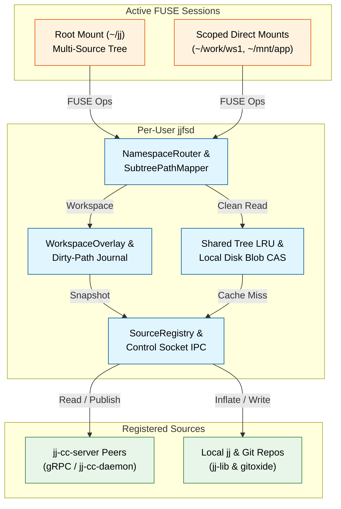
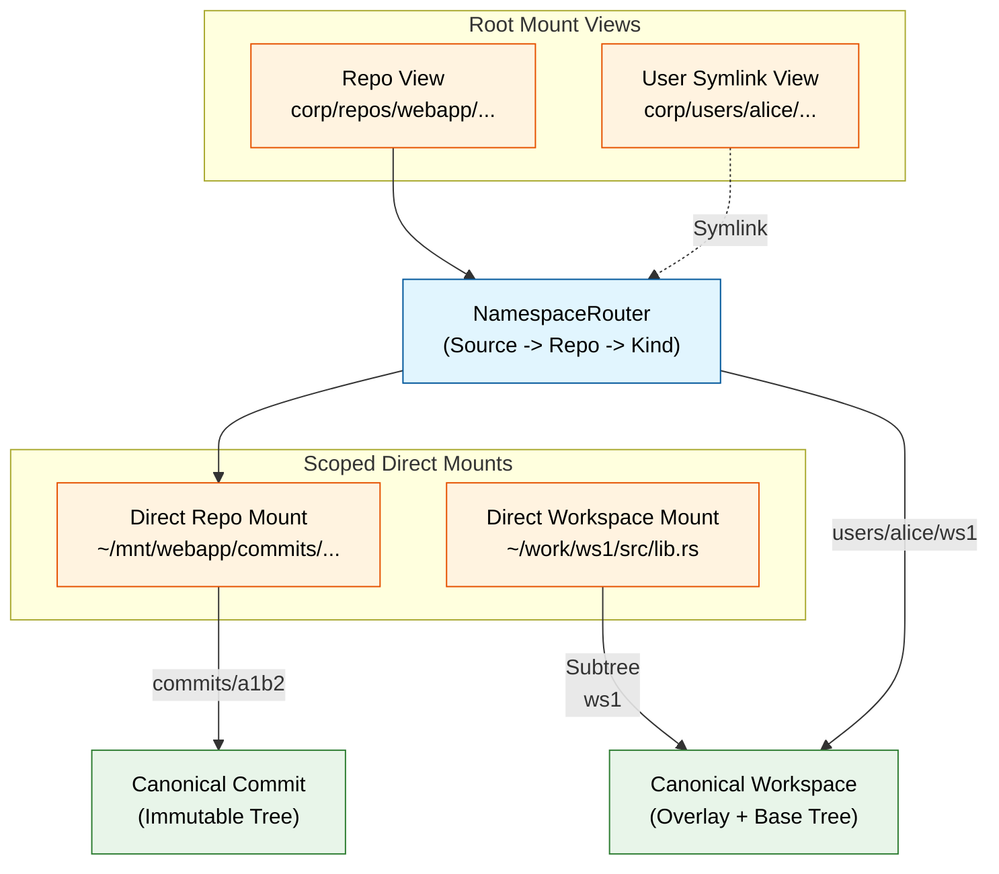
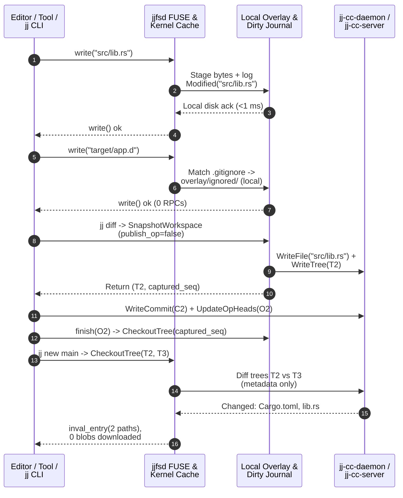

# jj-vfs Design and Multi-Source Proposal

## Summary

jj-vfs mounts [jj](https://github.com/jj-vcs/jj) workspaces, commits, bookmarks, and change trees on Linux via FUSE without cloning repository history or materializing untouched files on disk. A single per-user daemon (jjfsd) connects to multiple registered sources at the same time - including multiple remote [jj-commit-cloud](https://github.com/jj-vcs/jj-commit-cloud) servers (jj-cc-server, accessed over HTTP/2 gRPC or through a local jj-cc-daemon Unix socket) and multiple local jj and Git repositories backed by `jj_lib` and [gitoxide](https://github.com/GitoxideLabs/gitoxide).

One jjfsd process supports two complementary mount styles over a shared local blob cache, inode table, and per-workspace write overlay:

* **Root Namespace Mount (`~/jj`):** One FUSE mount exposes every registered source under `<mount>/<source>/repos/<repo>/...` and `<mount>/<source>/users/<user>/...`, letting developers, build workers, and agent orchestrators traverse into any registered repository, workspace, or immutable commit with zero `mount` syscalls per workspace.
* **Scoped Direct Mounts (`jj vfs mount <target> <dir>`):** Additional FUSE sessions inside the same jjfsd process mount any interior slice - a single workspace (`corp:webapp/default`), a user view (`corp:@alice`), a single repository (`corp:webapp`), or a single source (`corp`) - onto `<dir>` without outer `[source]` or `[repo]` path prefixes. Direct workspace mounts place `.jj/` and the working-copy tree at `<dir>`, establishing a kernel `st_dev` mount boundary that stops upward parent-directory walks by compilers, build tools, and language servers and isolates container bind mounts to one workspace.

| ID | Decision Question | Candidate Options | Quantified Trade-Offs and Constraints | Recommended Default |
| :-- | :-- | :-- | :-- | :-- |
| D1 | Should one jjfsd daemon run per OS user, per machine as root, or per mount point? | **A:** One per OS user + `--instance` override<br/>**B:** One root daemon per host<br/>**C:** One process per mount | **A** shares one cache and gRPC pool across $50+$ workspaces with zero root surface; **B** needs UID impersonation and in-daemon ACL checks; **C** multiplies RAM and sockets by $N$ mounts | **Option A** (keep `CallerContext` trait seam for future Kubernetes node daemonsets) |
| D2 | Should jj-vfs expose one root mount, multiple direct mounts, or both? | **A:** Dual mode (Root + Scoped Direct)<br/>**B:** Root mount only<br/>**C:** Per-workspace mounts only | **A** gives $0$-syscall `cd` access for CI/swarms and isolated `st_dev` boundaries for tools/containers using one router; **B** leaks sibling trees to upward parent walks; **C** needs a `mount` call per commit browse | **Option A** (one `NamespaceRouter` wrapped by `SubtreePathMapper` per session) |
| D3 | What path elements appear inside a mount point? | **A:** Positional `<source>/<repo>/<workspace>`<br/>**B:** User-first `<source>/users/<user>/<workspace>`<br/>**C:** Kind-disambiguated `repos/` + `users/` symlink view + scoped direct mounts | **A** collides with `commits/` and across users sharing workspace name `default`; **B** collides across repos where `<user>` has multiple `default` workspaces; **C** prevents name collisions and unifies both views on one canonical inode | **Option C** |
| D4 | How are sources registered and updated? | **A:** `$XDG_CONFIG_HOME/jj-vfs/config.toml` + live Unix socket IPC<br/>**B:** Startup CLI flags only | **A** adds or removes remote servers and local repos in $< 5\text{ ms}$ without unmounting active workspaces and defers network connections until lookup; **B** drops active file descriptors on config edits | **Option A** |
| D5 | How do writes reach jj and Commit Cloud in the First MVP? | **A:** Durable local disk overlay + `.gitignore` split + $2\text{ s}$ debounced snapshots + $O(k)$ `WorkingCopy` IPC<br/>**B:** Synchronous commit rewrite per `write()`<br/>**C:** Remote-only write-through | **A** keeps `write()` local ($< 1\text{ ms}$), keeps build outputs off the network, and snapshots $k$ dirty files with $0$ tree walks; **B** stalls $50\text{ writes/s}$ agent loops; **C** blocks saves on WAN RTT | **Option A** |

## Context

### Problem and Target Scale

Materialized local checkouts and single-repository virtual filesystem prototypes encounter four scaling walls under multi-agent and monorepo workloads:

* **Clone and Disk Amplification:** Spinning up $50$ to $1{,}000+$ concurrent coding agents on one repository copies gigabytes of packfiles and working-tree files across sandboxes before an agent reads its first file.
* **Full-Tree Snapshot Walks:** Standard working copies scan every directory on each jj command, turning $O(k)$ edits across $k$ modified files into $O(N)$ `stat` walks across $N = 100{,}000+$ tracked files.
* **High-Frequency Agent Writes:** A single coding agent in an edit-build-test loop issues up to $50$ file writes per second alongside multi-gigabyte compiler outputs under `target/` or `bazel-out/`. Rewriting a jj commit on every FUSE `write()` call or uploading ignored build artifacts saturates storage transactions and network bandwidth.
* **Multi-Destination Developer and Build Topologies:** Engineers and build hosts interact with more than one backing store on the same machine - such as a corporate jj-cc-server deployment, a public or personal jj-cc-server deployment, and several offline local jj or Git repositories. Each Commit Cloud deployment can host dozens of unrelated projects with disjoint commit graphs and up to $10{,}000$ workspaces per repository across users and agents.

For the First MVP on Linux (FUSE3), jj-vfs targets workspace mount setup under $200\text{ ms}$ at under $50\text{ ms}$ network RTT with $0$ cloned bytes, working-copy snapshot latency proportional to $O(k)$ dirty tracked paths, $0$ blob downloads when switching commits via `jj new` or `jj edit`, and $50+$ concurrent workspaces on one host sharing a single daemon and read cache.

### Building on jj-lib and Prior Virtual Filesystem Designs

jj-vfs implements upstream `jj_lib` working-copy traits (`WorkingCopy` and `LockedWorkingCopy`, preserving multi-side `MergedTree` and `ConflictLabels` state while pairing with jj-commit-cloud's `Backend`, `OpStore`, and `OpHeadsStore` implementations) and builds on the checked-in jjfsd proof of concept:

* **Existing jjfsd Layering:** The repository already separates the FUSE transport in [src/fuse.rs](../src/fuse.rs) (`JjFuse`) from path-to-inode translation in [src/vfs.rs](../src/vfs.rs) (`PathMappedVfs`) and [src/inode_map.rs](../src/inode_map.rs) (`InodeMap`), delegating layout resolution to `PathMapper` in [src/path_mapper.rs](../src/path_mapper.rs) and [src/path_mapper_all_commits.rs](../src/path_mapper_all_commits.rs). Resolving four prototype bottlenecks unlocks MVP scale: [src/main.rs](../src/main.rs) binds one local workspace per process, [src/commit_tree_file.rs](../src/commit_tree_file.rs) streams entire file blobs to compute `getattr` byte sizes, `PathMappedVfs` discards prefix bytes from offset $0$ on every ranged `read`, and [src/commits_directory.rs](../src/commits_directory.rs) enumerates all repository commits in memory.
* **Published Cloud VFS Precedents:** Google's Clients in the Cloud ([Potvin & Levenberg, CACM 2016](https://research.google/pubs/why-google-stores-billions-of-lines-of-code-in-a-single-repository/)) mounts one global namespace separating mutable user workspaces (`/google/src/cloud/<user>/<workspace>`) from immutable revision snapshots (`/google/src/files/<revision>`) and records dirty paths in the VFS so version control snapshots avoid tree walks. Meta's [EdenFS](https://github.com/facebook/sapling/blob/main/eden/fs/docs/Overview.md) runs one per-user daemon managing multiple direct checkout mounts backed by a shared local cache and per-mount write overlays. Combining both mount models in jjfsd supports global multi-source browsing and isolated per-workspace mounts within one architecture.

## Design

### Daemon Multiplicity and Process Model

One jjfsd daemon runs per OS user by default under that user's `uid` and `gid`, listening on `$XDG_RUNTIME_DIR/jj-vfs/control.sock` and storing persistent caches and workspace overlays under `$XDG_CACHE_HOME/jj-vfs/` and `$XDG_STATE_HOME/jj-vfs/`. Running a single daemon per user allows $50+$ concurrent human and agent workspaces on the host to share one in-memory tree cache, one content-addressed disk blob cache, and one pool of HTTP/2 gRPC channels (or jj-cc-daemon Unix socket connections) per remote server without requiring `root`, `allow_other`, or in-daemon POSIX UID impersonation.

Passing `--instance <name>` or `--state-dir <path>` launches an isolated jjfsd process with its own control socket, state directory, and FUSE sessions. Explicit instance isolation lets `cargo test` suites, jjfsd developers, and rootless container sandboxes run independent daemons on the same kernel without disrupting the user's primary mounts. Passing caller identity through a `CallerContext` struct on internal VFS calls preserves a clean seam for a future node-level daemonset mode on Kubernetes worker nodes.

<!--
Diagram styling and update instructions:
- Uses Mermaid flowchart TD with at most 2 peer nodes per rank and <br/> line breaks under 25 characters per line so rendered width stays well under 850px.
- Standard palette classes: #fff3e0 / #e65100 for kernel/mount surfaces, #e1f5fe / #01579b for jjfsd components, and #e8f5e9 / #2e7d32 for local and cloud storage backends.
- To update: edit node or edge declarations below and preview the rendered Mermaid block in Markdown.
-->


### Root Namespace Mount and Scoped Direct Mounts

jjfsd holds a table of active FUSE `BackgroundSession` handles inside one Tokio runtime, allowing the Root Namespace Mount and any number of Scoped Direct Mounts to coexist over the same `NamespaceRouter`:

* **Root Namespace Mount (`jj vfs mount ~/jj`):** Binds `NamespaceRouter` at path prefix `""`. Registering a new server or creating a cloud workspace exposes it under `~/jj/<source>/...` with zero kernel mount calls. Build clusters and multi-agent runners mount `~/jj` once at startup and `cd` into immutable commit or workspace paths in under $1\text{ ms}$.
* **Scoped Direct Mounts (`jj vfs mount <target> <dir>`):** Wraps the same `NamespaceRouter` in a `SubtreePathMapper` pinned to a concrete target prefix, omitting the outer `[source]` (and `[repo]` or `[workspace]`) segments from the mounted path:

| Mount Scope | Example Command | Mounted Root Contents at `<dir>` | Primary Use Case |
| :-- | :-- | :-- | :-- |
| **Root (All Sources)** | `jj vfs mount ~/jj` | `<source>/repos/...` and `<source>/users/...` | Zero-mount navigation across all servers and local repos |
| **Direct Source** | `jj vfs mount corp ~/corp` | `repos/<repo>/...` and `users/<user>/...` | Dedicated mount for one Commit Cloud server without `[source]` |
| **Direct User** | `jj vfs mount corp:@alice ~/alice` | `<repo>/<workspace>/<tree>` | Browse all workspaces of one user across repos without `[source]` |
| **Direct Repo** | `jj vfs mount corp:webapp ~/mnt/webapp` | `workspaces/`, `users/`, `commits/`, `changes/`, `bookmarks/` | Single-repo view matching existing `AllCommitsPathMapper` tests |
| **Direct Workspace** | `jj vfs mount corp:webapp/default ~/work/app` | `<tree>` plus `.jj/` at `<dir>/.jj` | Standard IDE, `cargo`/`bazel` build, or isolated container sandbox |

Direct workspace mounts solve two problems that a single global super-root cannot solve alone. First, developer tools (`cargo`, jj, `git`, `tsc`, `clangd`, formatters, and linters) walk upward through `..` searching for `.jj/`, `.git/`, workspace manifests, or ignore files; making `<dir>` its own FUSE mount point creates an OS `st_dev` boundary with `.jj/` at `<dir>/.jj` so parent walks terminate at the workspace root. Second, container runtimes bind-mount `<dir>` into an agent sandbox without exposing sibling workspaces, other users' directories, or other registered Commit Cloud servers to that container.

### Mount Path Grammar and Namespace Disambiguation

Designing the path hierarchy inside a multi-source mount must reconcile three structural properties of jj and Commit Cloud:

1. **Multiple Disjoint Repositories per Server:** A single jj-cc-server (or local directory source) hosts many independent repositories (`webapp`, `kernel`, `docs`) with unrelated commit graphs. Every jj repository initializes a workspace named `default`, so a path that omits `<repo>` (such as `<source>/users/alice/default`) collides whenever `alice` works in more than one repository on that server.
2. **Multiple Users and Agents per Repository:** Shared Commit Cloud repositories support up to $10{,}000$ workspaces keyed in `WorkspaceService` by `(repo_id, user, workspace_name)`. Two users (`alice` and `bob`) can each own a workspace named `default` or `fix-auth` inside `webapp`, so multi-user repositories require user disambiguation alongside ergonomic access to the caller's own workspaces.
3. **Repository-Scoped Commit Identities and Keyword Collisions:** Commit Cloud scopes `ReadCommit`, `ReadTree`, and `ReadFile` authorization to `repo_id` (backed by a shared per-project object pool). Placing `<mount>/commits/<commit_id>` at the root of a multi-source mount would force jjfsd to probe every registered server and repository on each cold lookup. Placing `commits/` alongside `<workspace>` inside `<repo>/` without a static category segment would also collide if a user creates a workspace named `commits` or `bookmarks`.

| Layout Option | Example Workspace and Commit Paths | Strengths | Failure Modes |
| :-- | :-- | :-- | :-- |
| **Option A: Flat Positional** | `<mnt>/<source>/<repo>/<ws>/<tree>`<br/>`<mnt>/<source>/<repo>/commits/<id>/<tree>` | Shortest path in single-user repos | Collides if `<ws>` is named `commits` or `bookmarks`; collides across users sharing workspace name `default` in one `<repo>` |
| **Option B: User-First** | `<mnt>/<source>/users/<user>/<ws>/<tree>`<br/>`<mnt>/<source>/commits/<id>/<tree>` | Mirrors single-monorepo cloud workspace paths | `<user>/default` collides across multiple repos on one server; top-level `commits/<id>` lacks `<repo>` routing context |
| **Option C: Kind-Disambiguated + Virtual Symlinks (Selected)** | `<mnt>/<source>/repos/<repo>/workspaces/<ws>/<tree>`<br/>`<mnt>/<source>/repos/<repo>/users/<user>/<ws>/<tree>`<br/>`<mnt>/<source>/repos/<repo>/commits/<id>/<tree>`<br/>`<mnt>/<source>/users/<user>/<repo>/<ws>` (symlink) | Zero name collisions; supports both repo-centric and user-centric browsing; preserves `<mnt>/commits/<id>` on repo mounts | Adds static `repos/` and `workspaces/` path segments in the un-scoped root mount |

Option C organizes every `<source>` under two top-level directories (`repos/` and `users/`), plus a convenience symlink `me -> users/<authenticated_user>`:

```text
<root_mount>/
└── <source>/                                                # Registered alias (corp, oss, local)
    ├── me -> users/<authenticated_user>
    ├── repos/
    │   └── <repo>/                                          # Repo name or repo_id (slash encoded as __)
    │       ├── workspaces/
    │       │   └── <workspace>/                             # Caller's workspace (or local repo workspace)
    │       │       ├── .jj/                                 # Synthesized .jj/ (Commit Cloud) or read-only local .jj/
    │       │       └── <tree>...                            # Read-write working copy tree
    │       ├── users/
    │       │   └── <user>/
    │       │       └── <workspace>/                         # Canonical multi-user workspace inode
    │       │           ├── .jj/
    │       │           └── <tree>...
    │       ├── commits/
    │       │   └── <commit_id>/                             # Read-only tree (40-hex ID or >=12-hex prefix)
    │       │       └── <tree>...
    │       ├── changes/
    │       │   └── <change_id> -> ../commits/<commit_id>    # Read-only symlink when non-divergent
    │       └── bookmarks/
    │           └── <bookmark> -> ../commits/<commit_id>     # Read-only symlink (nested slashes supported)
    └── users/
        └── <user>/
            └── <repo>/
                └── <workspace> -> ../../../repos/<repo>/users/<user>/<workspace>
```

Two rules keep this namespace fast and alias-free:

* **Single Canonical Workspace Inode via Kernel Symlink Resolution:** On a Commit Cloud source with an authenticated user `alice`, `repos/<repo>/workspaces/<ws>` and `users/alice/<repo>/<ws>` both return `FileType::Symlink` pointing to the canonical directory `repos/<repo>/users/alice/<ws>`. The Linux kernel VFS resolves relative symlinks to that single target inode, ensuring one `WorkspaceOverlay`, one kernel dentry/page-cache subtree, and `EXDEV` on cross-workspace `rename` or `link` calls.
* **Lookup-Only `commits/` Scaling:** On repositories with hundreds of thousands of commits, `lookup` under `commits/<commit_id>` resolves any full commit ID or unique prefix of length $\ge 12$ in $O(1)$ via `ResolveCommitPrefix`, whereas `readdir` (`ls commits/`) lists only commits pinned in memory on this host rather than streaming the entire repository history. When a user mounts a single repository via `jj vfs mount corp:webapp /mnt/webapp`, `SubtreePathMapper` binds `corp/repos/webapp`, exposing `/mnt/webapp/commits/<commit_id>/<tree>` and `/mnt/webapp/workspaces/<ws>/<tree>` at the mount root.

<!--
Diagram styling and update instructions:
- Uses Mermaid flowchart TD with at most 2 peer nodes per rank and <br/> line breaks under 25 characters per line so rendered width stays below 650px.
- Shows how Root Mount paths, User View symlinks, and Scoped Direct Mounts converge on canonical Repo Commit and Workspace nodes.
- To update: edit node or edge declarations below and preview the rendered Mermaid block in Markdown.
-->


### Source Registration and Control Plane

jjfsd persists source definitions and automatic mounts in `$XDG_CONFIG_HOME/jj-vfs/config.toml` and accepts live updates over `$XDG_RUNTIME_DIR/jj-vfs/control.sock` without restarting or unmounting active sessions:

```toml
[daemon]
root_mount = "~/jj"
max_cache_bytes = 21474836480 # 20 GiB

[sources.corp]
kind = "commit-cloud"
url = "https://cc.corp.example.com:443"
daemon_socket = "/run/user/1000/jj-cc-daemon/corp.sock"
user = "alice"
auth_token_env = "JJ_CC_CORP_TOKEN"

[sources.oss]
kind = "commit-cloud"
url = "https://cc.oss.example.org:443"
user = "alice-oss"
auth_token_cmd = ["gh", "auth", "token"]

[sources.local]
kind = "local-dir"
search_paths = ["~/src"]
repos = { jj-vfs = "~/src/jj-vfs" }

[[mounts]]
target = "corp:webapp/default"
mountpoint = "~/work/webapp"
```

Three `jj vfs` CLI subcommand families manage the lifecycle:

* **Source Management:** `jj vfs source add <alias> (--server <url> | --path <dir>) [--user <user>] [--token-env <VAR>] [--ephemeral]`, `jj vfs source list`, and `jj vfs source remove <alias>`. Removing a source checks for open file handles or un-snapshotted dirty overlay files under that source, returning `EBUSY` unless `--force` is supplied.
* **Mount Management:** `jj vfs mount [<target>] <mountpoint>` attaches either the root namespace (when `<target>` is omitted) or a scoped target (`<source>`, `<source>:@<user>`, `<source>:<repo>`, `<source>:<repo>/<ws>`, or `<source>:<repo>@<user>/<ws>`), auto-spawning jjfsd if `control.sock` is not listening. `jj vfs unmount <mountpoint>` flushes pending snapshots and detaches that FUSE session.
* **Lazy Activation:** Registering a source records only its configuration entry in memory. `SourceRegistry` opens a gRPC channel or loads a local `jj_lib` store on first path traversal into `<source>/repos/<repo>`, and subscribes only to workspaces mounted or opened on this host.

### Pluggable Read Backends, Local Write Overlay, and Working Copy Integration

To serve Commit Cloud, local jj, and local Git repositories through one FUSE and caching pipeline while avoiding prototype bottlenecks, jjfsd splits repository access into `ReadOnlyVfsBackend` and `WorkspaceOverlay`:

* **Metadata-First `ReadOnlyVfsBackend` and Ranged Reads:** `ReadOnlyVfsBackend` in [src/backend/mod.rs](../src/backend/mod.rs) exposes `resolve_commit`, `resolve_change`, `lookup_in_commit`, `list_dir_in_commit`, `read_file_range(commit_id_hex, rel_path, offset, size)`, `read_symlink`, and `diff_trees`. `DirectoryEntry` carries `{name, file_type}` for `readdir`, while `lookup_in_commit` returns `VfsLookup` with `FileAttributes` (file type, executable bit, and byte size populated from `TreeEntry` metadata in Commit Cloud or object headers in gitoxide and `jj_lib`), avoiding full-blob reads during `stat` and `ls -l` when metadata headers exist. On Commit Cloud sources, `read_file_range` calls `ReadFile` with `offset` and `max_bytes` (routing through jj-cc-daemon when configured). On local Git packfile sources, first read inflates the blob into jjfsd's local content-addressed disk cache so subsequent `pread(offset, size)` calls read cached byte ranges without re-inflating prefix bytes.
* **Durable On-Disk `WorkspaceOverlay` and `.gitignore` Split:** Every active workspace writes mutations into `$XDG_STATE_HOME/jj-vfs/overlays/<ws_id>/`. jjfsd evaluates in-tree `.gitignore` chains using `jj_lib::gitignore::GitIgnoreFile`. Ignored paths (`target/`, `node_modules/`, editor swap files) live as ordinary POSIX files in `overlay/ignored/` with full read-write `mmap`, `flock`, and mode bits and never upload to Commit Cloud. Tracked writes land in `overlay/staged/` and append an entry (`Modified`, `Added`, `Deleted`, `Symlink`, `Chmod`) to `overlay/journal.log`, surviving jjfsd restarts without blocking `write()` on network RTT.
* **Debounced Background Snapshots, Conflicted Commits, and $O(k)$ `VfsWorkingCopy`:** Commit Cloud workspaces synthesize `.jj/` at `$XDG_STATE_HOME/jj-vfs/workspaces/<ws_id>/.jj/` with working-copy type `"vfs"`, whereas `local-jj` mounts expose `.jj/` as read-only so source checkouts keep their own working-copy state. Loading `"vfs"` workspaces and invoking `jj vfs` subcommands require the integrated `jj` binary in [crates/jjfsctl/src/jj_main.rs](../crates/jjfsctl/src/jj_main.rs), which registers `VfsWorkingCopyFactory` and Commit Cloud store factories (a stock `jj` binary does not recognize working-copy type `"vfs"`). A per-workspace async mutex in jjfsd serializes background snapshots, `CheckoutTree` updates, and remote-head polling. Background snapshots verify that the reconciled `wc_commit_ids` entry and root tree match the cached base commit (skipping commits that are conflicted or have visible descendants requiring rebase) before publishing via `PublishOperation`. CLI commands run a two-phase snapshot: `LockedVfsWorkingCopy::snapshot` calls `SnapshotWorkspace { publish_op: false }` to upload the $k$ dirty paths and return `(tree_id, captured_seq)` while keeping staged files intact until `jj` commits its transaction and `finish()` sends `CheckoutTree` carrying `captured_seq`, which clears the staged snapshot, updates the workspace head, publishes `UpdateWorkspace`, and sends off-lock `fuser::Notifier` invalidations for changed paths. Multi-tree conflicted commits (`Merge<TreeId>` plus `ConflictLabels`) round-trip across `VfsWorkspaceRef`, `CheckoutTree`, and `vfs_state.json`; clean CLI snapshots return conflicted trees unchanged, and dirty overlays on unresolved conflicts return an error rather than collapsing conflict sides.

### Minimal Concrete Walkthrough

Consider repository `webapp` on source `corp` whose head commit $C_1$ contains `{Cargo.toml, src/lib.rs}`, mounted via `jj vfs mount corp:webapp/default ~/work/app`:

1. jjfsd resolves `corp:webapp/default` via `WorkspaceService::ListWorkspaces`, records base commit $C_1$ and root `TreeId` $T_1$, synthesizes `~/work/app/.jj`, and mounts FUSE in $< 50\text{ ms}$ with $0$ blobs fetched.
2. Running `ls -l ~/work/app/src` fetches only the `src` `Tree` proto, returning `lib.rs` attributes from cached tree metadata.
3. Opening and editing `~/work/app/src/lib.rs` hydrates the base blob on `open`, writes the modified bytes into `overlay/staged/src/lib.rs`, appends `Modified("src/lib.rs")` to `journal.log`, and returns from `write()` and `fsync()` once durable on local disk.
4. Running `cargo check` writes artifacts under `~/work/app/target/`, which match `.gitignore` and stay inside `overlay/ignored/target/` with zero Commit Cloud traffic.
5. Running `jj diff` inside `~/work/app` invokes `LockedVfsWorkingCopy::snapshot()`, which sends `SnapshotWorkspace { publish_op: false }` ($k = 1$ path: `src/lib.rs`) to upload the new blob and build $T_2$ while keeping `staged/src/lib.rs` on disk; `jj` then writes $C_2$ and $O_2$ in its transaction and calls `finish(O_2)` -> `CheckoutTree(T_2, captured_seq)`, which clears the clean staged entry, updates `WorkspaceService`, and prints the diff without scanning `src/` or `target/`.
6. Running `jj new main` (whose tree $T_3$ differs from $T_2$ only in `Cargo.toml` and `src/lib.rs`) invokes `CheckoutTree(T_2, T_3)`, invalidating kernel cache entries for those two paths while leaving `overlay/ignored/target/` intact for incremental builds and downloading $0$ blobs.

<!--
Diagram styling and update instructions:
- Uses Mermaid sequenceDiagram with compact init widths (4 participants) and <br/> breaks so rendered width stays under 760px.
- Traces local save, ignored build write, two-phase O(k) snapshot on `jj diff`, and 0-blob `jj new` tree switch.
- To update: edit sequence steps below and preview the rendered Mermaid block in Markdown.
-->


## Quality Attributes

* **Latency and Kernel Cache Offload:** Setting a $60\text{ s}$ FUSE entry and attribute timeout alongside `FUSE_READDIRPLUS` lets the Linux kernel dentry and page caches serve warm `stat` and `read` syscalls in $< 1\text{ }\mu\text{s}$ without crossing into user space, relying on targeted `fuser::Notifier` invalidations whenever local snapshots or remote head updates alter a path.
* **Crash Safety and Eviction Pinning:** Completed `write()` calls reside in `overlay/staged/` on the host filesystem and survive an unexpected jjfsd restart via `journal.log` replay; completed `fsync()` calls flush the staged file and journal to disk before returning. Unacknowledged staged files live outside the bounded LRU read cache (`$XDG_CACHE_HOME/jj-vfs/cas/`) and are never evicted; only clean blobs confirmed in Commit Cloud or a local repository store are subject to LRU eviction.
* **Concurrency and Sharded Inode State:** Replacing a single process-wide `Mutex` on `InodeMap` with concurrent sharded maps (`DashMap` keyed by `Inode` and `(parent_ino, Ustr)`) plus per-workspace overlay locks allows $64$-to-$128$-thread parallel builds to traverse directories and hydrate disjoint files without lock convoying.
* **1:1 Git Object Fidelity:** Preserving standard $20$-byte Git SHA-1 commit, tree, and blob identifiers across jj-vfs, jj-cc-daemon, and jj-cc-server ensures commits authored inside a VFS workspace round-trip through `jj cc export-git` and `jj git push` with identical Git hashes.
* **Per-User Security Isolation:** Running jjfsd under the mount owner's OS UID without `allow_other` restricts FUSE mount access and `control.sock` permissions (`0700` runtime directory) to that user, forwarding per-source Bearer tokens over TLS to each jj-cc-server.

## First MVP Execution Plan

| Scope Tier | Capabilities Included | Rationale |
| :-- | :-- | :-- |
| **In First MVP** | Multi-source registry (`commit-cloud`, `local-jj`, `local-git`, `local-dir`), per-user jjfsd + `--instance`, Root + Scoped Direct Mounts, metadata-only `getattr`, ranged `ReadFile`, local disk CAS, durable `WorkspaceOverlay` + `.gitignore` split, $2\text{ s}$ debounced snapshots, synthesized `.jj/` + $O(k)$ `VfsWorkingCopy`, targeted kernel cache invalidation, and $50$-workspace `xtask` benchmark | Delivers full Linux cloud-jj M1/M2 workspace lifecycle across Commit Cloud and local repos with 1:1 Git SHA-1 fidelity |
| **Deferred Post-MVP** | macOS ([FSKit](https://developer.apple.com/documentation/fskit) and [macFUSE](https://macfuse.github.io/)) and Windows ([ProjFS](https://learn.microsoft.com/en-us/windows/win32/projfs/projected-file-system)) drivers, content-defined chunking for $1\text{ TB}$ sparse mid-file edits, full offline rebase queueing, root multi-user Kubernetes node daemonset, and cross-machine ignored-file VFS server | Isolates OS-specific drivers and storage-format changes behind trait seams and benchmark gates |

Implementation proceeds as an 11-commit linear stack in jj-vfs (beginning with repository documentation guidelines in [AGENTS.md](../AGENTS.md)), where unit tests run without external services and FUSE mount and CLI e2e tests run when `/dev/fuse` and jj-cc-server are available:

1. **`docs(agents)`:** Check in [AGENTS.md](../AGENTS.md) establishing documentation structure, prose style, and Mermaid diagram conventions.
2. **`docs(design)`:** Check in `docs/design.md` establishing the multi-source architecture, mount grammar, control protocol, and MVP scope.
3. **`build(workspace)`:** Configure `rust-toolchain.toml`, wire `cc-lib` and workspace crates (`vfs-proto`, `jjfsctl`, `xtask`), and add Apache-2.0 headers and test helpers.
4. **`refactor(backend,inode)`:** Introduce the `ReadOnlyVfsBackend` trait with metadata-first `lookup_in_commit` and ranged `read_file_range`, shard `InodeMap` for concurrent lookups, and add local `jj_lib` and gitoxide disk-CAS blob inflation (eliminating full-file `getattr` reads and $O(\text{offset})$ discard reads).
5. **`feat(cc-backend)`:** Implement `CommitCloudVfsBackend` using `cc-lib` pooled gRPC channels (and optional jj-cc-daemon Unix sockets), supporting ranged `ReadFile` streams, `ResolveCommitPrefix`, and lookup-only `commits/` resolution.
6. **`feat(registry,ipc)`:** Add `SourceRegistry`, `$XDG_CONFIG_HOME/jj-vfs/config.toml` persistence, and `$XDG_RUNTIME_DIR/jj-vfs/control.sock` RPCs with the `jj vfs` (`jjfsctl`) CLI (`source add/list/remove`, `daemon start/status/stop`).
7. **`feat(namespace,mounts)`:** Implement `NamespaceRouter` (canonical `repos/<repo>/{workspaces,users,commits,changes,bookmarks}` + `users/<user>/<repo>/<ws>` virtual symlinks) and multi-session `SubtreePathMapper` supporting concurrent Root and Scoped Direct Mounts (`jj vfs mount` / `unmount`).
8. **`feat(overlay)`:** Build the durable on-disk per-workspace `WorkspaceOverlay` (`overlay/staged/`, `overlay/ignored/`, `journal.log` crash replay, and `jj_lib` `.gitignore` chain evaluation) with full FUSE write, create, unlink, mkdir, rmdir, rename (`EXDEV` across workspaces), truncate, symlink, and chmod endpoints.
9. **`feat(snapshot,wc)`:** Add debounced ($2\text{ s}$) background dirty-blob upload and `PublishOperation` snapshots, synthesized per-workspace `.jj/` directories, and two-phase `VfsWorkingCopy` (`WorkingCopy` + `LockedWorkingCopy`) for $O(k)$ zero-walk CLI snapshots.
10. **`feat(cache,invalidation)`:** Enable $60\text{ s}$ kernel attribute/entry caching, bounded LRU clean-blob eviction (pinning unacknowledged overlay files), and targeted `fuser::Notifier` kernel invalidation on `CheckoutTree` (`jj new`, `jj edit`, `jj rebase`) and remote workspace head updates.
11. **`feat(xtask,docs)`:** Add `cargo xtask` end-to-end smoke tests and a $50$-workspace multi-source benchmark across two live jj-cc-server instances plus local repositories, and update [README.md](../README.md) with quickstart and multi-mount workflows.

## Vision and Future Directions

* **macOS and Windows Endpoints:** Because `JjFuse` sits above `VirtualFilesystem`, `NamespaceRouter`, and `WorkspaceOverlay`, future milestones can attach a macOS driver via Apple FSKit and macFUSE and a Windows Projected File System (ProjFS) adapter without rewriting source routing, caching, or Commit Cloud synchronization.
* **Node-Level Kubernetes Daemonsets:** Extending `CallerContext` to inspect FUSE request `uid` and `gid` headers and map container mount namespaces to per-sandbox credentials enables a single node-level jjfsd daemonset to provision workspaces for hundreds of ephemeral agent pods per node.
* **Content-Defined Chunking and Live Ignored-File Sync:** If partner benchmarks on $> 5\text{ GiB}$ mutable binary assets show whole-blob background uploads saturating uplink bandwidth, content-defined chunking can layer beneath `BlobStore` as an internal transfer representation while preserving external Git blob hashes, followed by an optional jj-vfs-server for roaming ignored build caches across machines.
