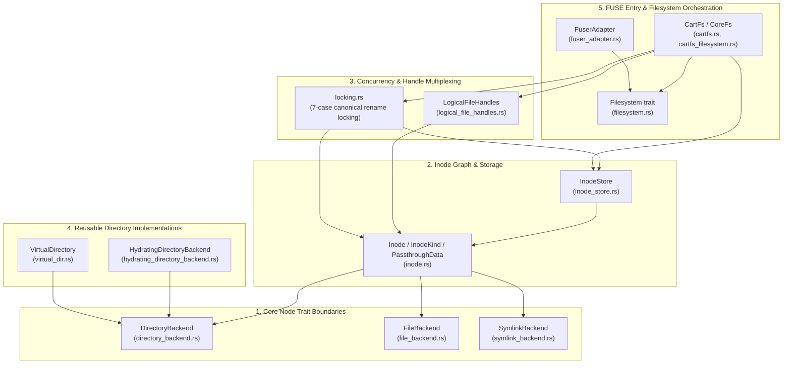

# Core VFS Overview

## Core Trait Boundaries

Decouples POSIX filesystem dispatch from how directories, files, and symlinks store metadata and bytes.

### DirectoryBackend

Defines all operations on a single directory node:
- **Membership & lookup**: `is_empty`, `lookup`, `find_name_by_inode`, `get_children_count` (excluding `.` and `..`), `add_child`, `remove_child`. Note that `add_child` and `remove_child` do not update the child's `parents` list; callers (such as `CartFs` under `locking.rs` guards) own parent-link consistency.
- **Directory enumeration**: `opendir` (returns `OpendirResult` with `directory_handle` and `can_cache`), `readdir` (invokes `ReaddirCallback` with `(INodeNo, offset, FileType, &OsStr)`), and `releasedir`.
- **Entry creation**: `mknod`, `mkdir`, `symlink`, and `register_file` (defaulting to `ENOTSUP`/unimplemented; used for pre-registering CAS-backed files with digest, size, and pull urgency).
- **Attributes, digests & persistence**: `getattr`, `setattr`, `get_digest` (SHA-256 of entries), `to_persisted_backend`, and `get_persisted_metadata`.

### FileBackend

Defines I/O and lifecycle for regular files and special file nodes:
- **Data path**: `open` returns `OpenResult { fd: FileDescriptor, can_cache }`, where `FileDescriptor` is either `Stateless` (VFS routes `read`/`write` through `FileBackend::read` and `FileBackend::write`) or `NativeHandle(FileHandle)` (kernel or FUSE passthrough reads/writes directly against an OS file descriptor). `release` is called asynchronously by FUSE on handle close.
- **Metadata & allocation**: `getattr`, `setattr` (supports `FileSizeUpdate` and timestamps/permissions), and `fallocate`.
- **CAS & persistence hooks**: `get_digest`, `snapshot_local_file`, `is_dirty`, `to_persisted_backend`, and `get_persisted_metadata`.

### SymlinkBackend

Minimal trait for symbolic links:
- **Operations**: `readlink` (returns `OsString`), `getattr`, `setattr`.
- **Persistence hooks**: `to_persisted_backend`, `get_persisted_metadata`.

## Inode Graph & Storage

### Inode

`Inode` is the VFS-level POSIX node stored in `InodeStore` and locked individually during operations.

`Inode` is the heart of `core_vfs`, but currently couples to `WorkspaceId` bit-packing, `persistence_proto`, and `PassthroughData` (whose backing `FileBackend` implementation `RegularFile` lives in Mode 2). Also refcounting—inodes are never deleted or evicted on FUSE `forget`.

- **Identity & addressing**: `id: INodeNo` packs a 20-bit `WorkspaceId` (upper bits; `0` means `None`) and a 44-bit local inode number (`LOCAL_INO_MASK`) via `encode_inode` and `decode_inode`.
- **Parent tracking & `nlink`**: `parents: Vec<INodeNo>` tracks every directory entry pointing to this inode (including duplicate entries if hard-linked multiple times in the same directory). `backend_attr_to_attr` derives `FileAttr.nlink` directly from `parents.len()`. `add_remove_parent` updates `parents` atomically during `link`, `unlink`, and `rename`.
- **Ownership**: `uid` and `gid` live on `Inode` (populated from `UserContext` or `restore`, mutated by `setattr`) rather than inside backends.
- **Polymorphic payload (`InodeKind`)**:
  - `Directory { backend: Box<dyn DirectoryBackend> }`
  - `File { backend: Box<dyn FileBackend>, open_count: u32, passthrough_data: Option<PassthroughData> }`
  - `Symlink { backend: Box<dyn SymlinkBackend> }`
- **Passthrough state (`PassthroughData`)**: Holds `backing_id: fuser::BackingId` and `native_handle: fuser::FileHandle`. On first open when passthrough is enabled, `CartFs` calls `reply.open_backing(fd)` and caches `PassthroughData` on the inode; subsequent opens reuse it while incrementing `open_count`. When `open_count` drops to `0` on `release`, `passthrough_data` is set to `None` (dropping `BackingId` to close the kernel backing file) and `backend.release` is called.
- **Persistence**: `restore`, `to_persisted`, and `to_persisted_with_attr_and_backend` serialize/deserialize `PersistedInode` protos.

### InodeStore

Thread-safe registry mapping `INodeNo -> Arc<Mutex<Inode>>`:
- **Structure**: `inodes: RwLock<HashMap<INodeNo, Arc<Mutex<Inode>>>>` plus `next_inode_id: AtomicU64` initialized to `INodeNo::ROOT.0 + 1`.
- **ID allocation**: `next_inode_id(parent)` extracts the parent's `WorkspaceId` and atomically increments the 44-bit local counter; `next_inode_id_for_workspace` targets an explicit workspace; `set_next_inode_id` advances the counter monotonically via `fetch_max` during startup recovery.
- **Documented lock hierarchy**:
  1. Keep the outer `RwLock` brief; never run I/O while holding it.
  2. Never acquire an individual `Inode` `Mutex` while holding the map `RwLock`.
  3. Acquiring the map `RwLock` while holding an `Inode` `Mutex` is permitted.
  4. Multiple `Inode` `Mutex`es must be acquired in ascending `INodeNo` order.
- **Removal**: `remove_inode` is explicitly restricted to rollback on failed workspace creation because exposed inodes may still be cached by the kernel.

## Concurrency

### locking.rs

Implements deadlock-free multi-inode locking for `rename`, `link`, and `unlink`/`rmdir` without a global filesystem write lock.

- **Core mechanism (`acquire_locks_once`)**: Takes a slice of `INodeNo`s, sorts and deduplicates them in canonical ascending `INodeNo` order, looks up each `Arc<Mutex<Inode>>` from `InodeStore`, and locks them sequentially. It extends `MutexGuard<'_, Inode>` lifetimes to `'a` alongside the owning `SmallVec<[Arc<Mutex<Inode>>; 4]>` so callers receive named guards without self-referential struct issues.
- **Optimistic lookup + double-check loop (`lock_for_rename`, `lock_for_remove_entry`)**:
  1. Perform `optimistic_lookup` on parent directory/directories (locking one parent at a time) to discover child `INodeNo`s.
  2. Acquire all involved inodes (up to 4: `src_parent`, `tgt_parent`, `src_child`, `tgt_child`) in canonical order via `acquire_locks_once`.
  3. Re-verify via `verify_child` that directory entries still map to the same `INodeNo`s under the held locks; retry the loop if a concurrent mutation raced.
- **All 7 `LockedRenameTopology` cases**:
  1. `SameDirectory`: `src_parent == tgt_parent`, target does not exist.
  2. `NoOp`: `src_parent == tgt_parent`, target exists and is `src_child` (e.g. `rename("a", "a")`).
  3. `SameDirectoryOverwrite`: `src_parent == tgt_parent`, target exists and is a different inode.
  4. `Distinct`: `src_parent != tgt_parent`, target does not exist.
  5. `DistinctOverwrite`: `src_parent != tgt_parent`, target exists (and is not `src_parent`).
  6. `IntoSelf`: `src_child == tgt_parent` (e.g. `mv a a/b`).
  7. `RenameToParent`: `tgt_child == src_parent` (e.g. `mv a/b a`).
- **Helpers**: `lock_for_link` locks `(ino, newparent)` in canonical order; `lock_for_remove_entry` handles both `unlink` and `rmdir`.

### LogicalFileHandles

Decouples FUSE `FileHandle` IDs returned to the kernel from physical OS file descriptors (`FileDescriptor`):
- **State**: `next_logical_file_handle_id: AtomicU64` (starts at `1`, avoiding `0`) and `active_logical_file_handles: Mutex<HashMap<FileHandle, FileDescriptor>>`.
- **Multiplexing**: In FUSE Passthrough mode, multiple concurrent `open()` calls on the same inode receive distinct logical `FileHandle`s that all map to the same shared `FileDescriptor::NativeHandle(passthrough.native_handle)` stored on `InodeKind::File`. In non-passthrough mode, each logical handle maps to its own `FileDescriptor` (or `Stateless`).
- **Why it matters**: Prevents `RLIMIT_NOFILE` exhaustion under parallel build (`siso`/`ninja`) or multi-agent workloads where hundreds of threads open the same header/source files simultaneously.

## Directory Implementations

### VirtualDirectory

An in-memory mutable `DirectoryBackend` implementation:
- **Dual `readdir` strategy**: Lazily initializes `entries: Option<Box<dyn DirEntries>>` on first access based on `context.enable_stateless_readdir`—choosing either `StatelessDirEntries` (offset-based, supporting kernel readdir caching) or `StatefulDirEntries` (cursor state per `opendir` handle).
- **In-memory mutations**: Implements `lookup`, `find_name_by_inode`, `add_child`, `remove_child`, `get_digest`, and `setattr`/`getattr`.
- **Node creation**: `mknod` creates a `RegularFile` (`FileSource::Local`), `mkdir` creates a child `VirtualDirectory`, `symlink` creates a `SymlinkFile`, and `register_file` creates a `RegularFile` (`FileSource::RegisteredCas`) and optionally spawns eager CAS prefetching.
- **Persistence**: Serializes as `VirtualDir` in `persistence_proto`.

### HydratingDirectoryBackend

A generic lazy-loading wrapper `HydratingDirectoryBackend<NotHydrated, Hydrated, Hydrator>` implementing `DirectoryBackend`:
- **Three-state machine (`HydratingState`)**:
  - `NotHydrated(NotHydrated)`: Holds lightweight configuration data before first directory access. `getattr` returns `not_hydrated_attr` without triggering hydration, keeping `stat` storms cheap. `releasedir` is a no-op.
  - `Hydrated(Hydrated)`: Holds the materialized `DirectoryBackend` and forwards all calls directly.
  - `Error(CartFsError)`: Caches hydration failure so subsequent calls fail deterministically without retrying a broken hydrator.
- **Async transition (`ensure_hydrated`)**: On the first operation requiring directory contents (`lookup`, `opendir`, `readdir`, `is_empty`, `mknod`, `mkdir`, `symlink`, `setattr`, etc.), replaces `NotHydrated` with a temporary `Error("Hydration interrupted")` guard, consumes `hydrator: Option<Hydrator>`, and executes `context.block_on(hydrator(context, state))` to transition to `Hydrated` or `Error`.
- **Pre-hydration persistence**: `with_persistence` accepts a function pointer `fn(&NotHydrated) -> Option<persisted_inode::Backend>`, allowing unhydrated directories to be persisted and restored across daemon restarts without forcing eager hydration.

## FUSE Entry & Filesystem Orchestration

### FuserAdapter

Kernel-facing `fuser::Filesystem` implementation that bridges `fuser` callbacks to `Arc<dyn Filesystem>`:
- **Request translation**: Extracts `UserContext` (`uid`, `gid`, `pid`) from `fuser::Request`, invokes the corresponding `Filesystem` method, and converts errors into `fuser::Errno` replies while logging unexpected errnos.
- **Cache invalidation**: Triggers `notify_inval_inode` on parent directories after mutating operations (`link`, `rename`, etc.) when `enable_readdir_caching` is enabled.

### Filesystem

Internal `Send + Sync` filesystem trait decoupled from `fuser::Request` and `Reply*` types for unit testing and clean VFS boundaries:
- **Core POSIX surface**: `init`, `lookup`, `getattr`, `statfs`, `setattr`, `mknod`, `mkdir`, `symlink`, `unlink`, `rmdir`, `rename`, `link`, `open` (takes `ReplyOpen` for `open_backing` passthrough setup), `read`, `write`, `release`, `opendir`, `readdir`, `releasedir`, `readlink`, `fallocate`, `fsync`, and `fsyncdir`.
- **Kernel notifications & helpers**: `notifier`, `notify_inval_entry`, `notify_inval_inode`, `rt`, and `create_context`.

### JJFilesystem

The concrete `Filesystem` implementation that wires together the lower VFS layers:
- **Core VFS mechanics (kept in `core_vfs` as `CoreFs`)**:
  - Owns `InodeStore`, `LogicalFileHandles`, `next_directory_handle_id`, `passthrough_enabled`, `dir_path_to_ino_cache`, and `notifier`.
  - Dispatches `rename` across `LockedRenameTopology` cases via `lock_for_rename` (with `RENAME_EXCHANGE` and `RENAME_NOREPLACE` support), `link` via `lock_for_link`, and `unlink`/`rmdir` via `lock_for_remove_entry`.
  - Manages `FUSE_PASSTHROUGH` (`reply.open_backing`, `PassthroughData`, `open_count`, and `LogicalFileHandles` multiplexing).

### Known Gaps
1. Incomplete `FUSE_PASSTHROUGH`: `InodeKind::File` and `LogicalFileHandles` include the passthrough plumbing, but jjfsd must supply its own `FileBackend` returning `FileDescriptor::NativeHandle`.
1. No forget / inode eviction: `InodeStore` retains all inodes for the lifetime of the mount, which suits short-lived CI builds but requires race-free `forget` eviction for long-lived developer workstations.
1. Linux-only: `fuser` types and `RawFd` assumptions are Linux-specific.
